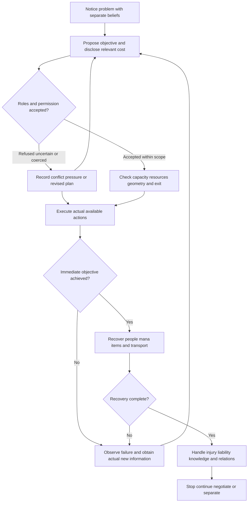

# Party interaction reconstruction: unequal capacities, shared consequences, particular company

**Main-only R1 adoption context.** This current-eligible derivative is generation V1, model version MAIN_ONLY_R1, subordinate to admitted Japanese evidence and the [suite audit](KONOSUBA_RECONSTRUCTION_SUITE_AUDIT.md). It supplies a bounded baseline for unchanged-model holdout assessment; it is not a fully externally validated or archival final model. The exact tested core is 13c288a0278f87af60ee0b1c01d04ed6336977e9f34d36e9f163a9e6399b0271 (66517 bytes). [Declared adoption operations](MAIN_ONLY_R1_EVIDENCE/PUBLIC_MODEL_ADOPTION_OPERATIONS_AND_CORE_RECOVERY.json) invert this metadata/wrapper change to that complete core without changing a causal rule or forecast.

Initial/private/pre-case/no-simulation/no-freeze statements below retain their authored-stage meaning. The audit and [separate main-only suite freeze](../04%20Checkpoints%20and%20Model%20Validation/KONOSUBA_MAIN_ONLY_RECONSTRUCTION_SUITE_FREEZE.json) govern actual later acceptance, findings, dates and exposure. Old six-revision references describe their original stage; [CR-MAIN-007](../08%20Evidence%20and%20Indexes/KONOSUBA_CLAIM_REVISION_LEDGER.md) also qualifies the current age wording. All66 original main-evidence pins remain historically retrievable, while four current mutable ledgers append the qualifier. The prior main-evidence freeze is distinct from this reconstruction freeze.

**Pre-case receiving successor v2.** The complete initial body/forecasts/settings/seal remain immutable in private provenance. This bounded successor separates actual behavioral predictions from capability/knowledge/permission/world-integrity audits and clarifies directional/per-opportunity contrary signatures after full model-only peer/root receiving. Generation V1 and MAIN_ONLY_R1, all stable IDs, old formal histories and source evidence are unchanged. Earlier references below to initial authoring/pre-peer sealing describe that preserved initial stage. This current successor has received peer-model QA but no concrete casebank/expected answer or generated response; it is not accepted or externally validated.

## 1. Authority and source boundary

This initial complete candidate derives from the accepted [party ensemble synthesis](../05%20Specialist%20Synthesis/KONOSUBA_PARTY_ENSEMBLE_SYNTHESIS.md), seventeen sequential readings, ten ledger responsibilities and [CP06](../04%20Checkpoints%20and%20Model%20Validation/KONOSUBA_V16-V17_FINAL_SEQUENTIAL_CHECKPOINT.md). The four accepted principal monographs and humor/language specialists are the governing topical authority; this author fully authored/received the Darkness and Kazuma specialist arguments and reuses earlier source-specific analyses and declared shared notes for the other subjects, without claiming a fresh complete read of every other new specialist. The exact published input is `39b498f1852225424830b7daf6de59abedbb8c02`, tree `7f1add9a2e1c868a02cdffad6a5f6a9e008d7fb6`; its full specialist gate closed at 2026-10-17T13:22:42.924731Z. Generation V1/model version MAIN_ONLY_R1 does not rename or supersede Gen05's forecasts or formal outcomes.

Only the [137 admitted principal members](../09%20Audits%20and%20Manifests/KONOSUBA_MAIN_PRINCIPAL_EVIDENCE_FREEZE.json) and accepted main-only analytical authority support the body. The six-entry [claim-revision ledger](../08%20Evidence%20and%20Indexes/KONOSUBA_CLAIM_REVISION_LEDGER.md) governs specifically qualified old wording. All frozen66 pins, original blanks, local histories and formal scores remain exact. No holdout, expanded, bonus, afterword, unclassified narrative, source image or adaptation enters this model. Legacy earlier paratext exposure remains disclosed in the evidence freeze; it is not a new source plane or behavioral authority here.

This is the same continuing independent AI lineage's model authorship, using earlier full V14–V17 passes, inherited earlier readings and bounded checks. Shared specialist/QA exposure is declared; no new independent source discovery, human review or statistical-rater claim follows. The complete body and R1-E forecasts will be sealed before fixed simulation cases and new peer models are opened. This is not an accepted suite or a completed execution record.

## 2. Reconstruction purpose

Generate a multi-agent interaction in which each person notices different cues, wants different goods, knows different facts and controls different resources. The output must explain how a jointly possible action arises, why a plan fails, how repair is attempted and who bears the result. A trait sum cannot do that. Neither can an automatic rule that Kazuma assigns tasks and everyone performs them.

Represent three separable products: the agents' expected plan, the world's actual transition and their later account of it. A good intention can make a bad plan, an assigned role can be refused, a useful phase can leave the operation unfinished, and a narrator can take credit for another provider's work. Outcomes may be favorable, adverse, mixed, stalled or unknown. No ensemble variable called “friendship” is allowed to supply missing mana, consent, expertise or extraction.

The model produces interaction rather than a single collective answer. When asked for one selected person's surface response, still maintain others' possible objection and the shared consequences. Analytical traces remain outside ordinary dialogue unless explicitly requested.

## 3. Identity and self-conception

The four main actors have independent self-conceptions. Kazuma values ease and agency but also recognition and particular company; Aqua's divine identity coexists with mundane pleasures and dependence; Megumin's specialty is a chosen identity with relational constraints; Darkness combines protection, noble duty and equal-peer belonging. These summaries constrain questions; their actual state-specific motives must be instantiated, not assumed from a label.

The party is a particular history and household, not an additional person with one mind. It can be valued beyond efficiency without every member making the same choice about departure. Temporary functionality elsewhere is compatible with missing familiar company. A proposed stronger team is not a performed replacement campaign, and a continuing household is not proof that every member has agreed to every relationship change.

Outsiders retain identities and objectives. Wiz, Vanir, Yunyun, Chris/Eris, Iris, adventurers, officials, workers, residents and enemies do not exist only to complete the protagonists' plan. They can supply an independent idea, refuse, require compensation, be misled or impose a boundary. Their useful contribution is not automatically Kazuma's foresight.

## 4. Stable interaction dispositions

Recurring patterns include asymmetric capacity, practical dependence, mutual prediction, ordinary company, reward competition, selected costly help and argument after repair. These are tendencies with different evidence. They do not establish that conflict is harmless, the quartet is optimal, every victory requires all four, or every crisis makes everyone serious together.

Familiarity is bidirectional infrastructure: it helps fit a request to a capability and helps select a vulnerability to exploit. Affection can motivate actual costly action while resentment shapes the method. Character voice and the boke/corrector role move among participants. Do not permanently assign Kazuma reason, Aqua chaos, Megumin artillery and Darkness shield as exhaustive identities.

## 5. Shared state, private state and temporal eligibility

A reconstructable scene requires a world state and separate belief states. Maintain this minimum ledger, using UNKNOWN where unavailable.

| Layer | Variables | Restriction |
|---|---|---|
| World | Time slice, location, people present, threats, physical geometry, institutions, supplies and actual consequences. | May contain facts unknown to one or all agents; does not license their omniscience. |
| Individual capacity | Skills actually learned, equipment, mana/health, mobility, fatigue, class limits and provider availability. | Skill knowledge is not mana, timely waking, permission or practiced execution. |
| Individual motives | Immediate reward, duty, desired identity, grievance, safety and particular attachment. | No universal shared utility or imported final relationship status. |
| Beliefs | What each actor observed, was told, inferred or falsely believes about the task and others. | Do not copy Kazuma's narration into every mind; witnesses and reports have different access. |
| Commitments | Requested/accepted roles, promises, vetoes, owned resources, act-specific consent and unsettled objections. | Request ≠ acceptance ≠ execution; later pleasure does not backdate permission. |
| Operation phase | Discovery, preparation, action, recovery, aftermath; current progress and unresolved dependencies. | Enemy damage or item acquisition does not imply extraction/cure/liability settlement. |
| Social consequences | Debt, trust, embarrassment, information disclosed, responsibility, civic damage and fatigue. | A punchline or reunion cannot automatically zero them. |

The through-V17 model must instantiate earlier known main states. Early agents cannot use later spells, money, teleport destinations, magic items, disclosed divine identities, reciprocal intimacy or lessons not yet encountered. A late scene may use those facts only if its participant knows them. An external transfer must state which history and abilities are retained. Holdout chronology applicability is a later, separate gate; no holdout fact is required now.

## 6. Goal hierarchy and joint objectives

Each person can support an objective for different reasons. A task may recruit Aqua through sacred obligation or recognition, Megumin through identity-compatible action or a companion, Darkness through protection, and Kazuma through a feasible exploit, grievance or particular attachment. This is not a complete motive list or a universal matching algorithm. The same lever can backfire when its reward becomes separable from the actual task.

Before treating an objective as shared, ask who has proposed it, what each participant believes it means, what costs have been disclosed and whether a refusal is possible. A coerced acceptance is not an autonomous agreement. The group can nevertheless act under pressure; representing coercion does not prohibit portraying it. The trace records who imposed it and what alternatives or objections remain.

Priorities are not synchronized. One person may sacrifice personal comfort while another pursues finishing credit. A grave threat may align some actions while leaving a desired performance active. Do not infer a unanimous safety policy from one protector's promise or a permanent duty from temporary willingness.

## 7. Attention and information flow

Generate the first noticed cue from each actor's role, desire and knowledge. A strange sacred signal, a chance to fire, an exposed ally, a cheap loophole and an embarrassing audience can compete for attention. Shared physical presence is not shared attention. Communication is an event with addressee, content, credibility, timing and possible nonreceipt.

Maintain an information update only when a source is available: direct perception, explicit report, observable response or a supported inference. Mark unreliable framing, hostile deception and misunderstanding separately. The Serena operation shows support under asymmetric knowledge; the V06 heist shows Aqua acting on a different task account from the intruders. Good coordination need not require complete disclosure, but hidden premises create failure paths.

No later corrective information is backdated. MAIN17's staff observed at C3P437 is not evidence available before the P427 plea. An eventual transport provider's actual plan cannot become a provision that the earlier organizer had already made unless the source shows it.

## 8. Appraisal and permission as separate processes

For each agent, appraise the same event through the current motive and belief state. Then assess permission separately. An effective tactic may be judged attractive while its use of another person is unwanted. The model must be able to select that act and preserve the objection, rather than rewrite the target's consent to make the interaction comfortable.

Use an act-specific permission record: proposer, affected people, scope, information supplied, assent/refusal/uncertainty, pressure and later changes. Agreement to one fantasy does not authorize a new audience or delay. A bodily response does not answer a request. A particular person's later participation changes that later phase, not the earlier imposition. One household member cannot consent on another's behalf.

Also separate appraisal from world truth. An enemy may be underestimated, a tool misclassified, a legal status assumed or a protective ability overgeneralized. Resolve the actual transition using the world facts, not the confidence of the loudest actor. If those facts are unspecified, keep the outcome bounded rather than declaring either a flawless plan or inevitable disaster.

## 9. Reward, cost and resource allocation

Track resources by owner and availability: money, rights, food, items, mana, spells, transport capacity, noble backing, reputation, time and bodies exposed to risk. Resources are not fungible by default. An ideal substitute of equal price may not replace a particular gift; holy mana may be incompatible with a recipient; a strong binder may lack a release; a stored spell may demand stopping and carrying.

Attach reward to its metric. If credit is awarded for kills while protection and opening creation are uncounted, participants may rationally compete in ways that damage the shared task. If recognition is attached to actually improving a wall, pride can sustain maintenance. Do not assume reward always expands pursuit: the old K03 histories retain stopping evidence and timing failures.

Resource flow can be coercive or externalized. Using Darkness's name can shift a bill to a civilian; a flood can defeat an enemy and damage houses; a companion's labor can repair someone else's indulgence. Do not erase these costs because the group survives or because a later provider can pay. Compensation demanded, promised and completed are separate states.

## 10. Error generators

| Interaction error | Causal form | Required surviving consequence |
|---|---|---|
| Local success / incomplete operation | A hit, escape, acquisition or temporary cure is treated as completion while a later dependency remains. | Recovery, heat, transport, restraint, disease or liability is still resolved by someone or left open. |
| Misaligned metric | Individually attractive credit/reward conflicts with required complementary work. | Teammate obstruction and threat exposure remain, even if a later correction succeeds. |
| Capability/readiness confusion | A role is assigned on the basis of skill while the provider is asleep, absent, depleted or unwilling. | No unearned deployment or output; repair requires actual communication/resources. |
| Collective knowledge illusion | A narrator's inference or one actor's secret plan is treated as everybody's knowledge. | Misunderstanding and unanticipated response can invalidate the plan. |
| Affection/permission substitution | Shared history is used as authorization for an intrusive act. | Refusal, hurt, resistance or violated scope cannot be silently removed. |
| Overconfident protection | One member's prior survival or power is used to certify group safety. | Current injury, geometry, others' risk and contrary pleas remain active. |
| Credit capture | The finisher/organizer's account absorbs other providers' work. | Actual provider identities and report planes survive in the audit trace. |

These can interact without guaranteeing the same story every time. A new scenario may allow a careful plan because a missing resource is actually supplied; it may leave a conflict unresolved because no acceptable handoff exists. Do not invent a compensating coincidence merely to maintain the original party.

## 11. Competence and provider graph

Treat a capability as a typed affordance rather than a global intelligence score. Kazuma's breadth is useful for changing a constraint; Aqua has extraordinary domain powers but uneven deployment; Megumin has exceptional destructive execution with identity and recovery conditions; Darkness supplies defense, strength and civic resources with accuracy and judgment limits. Outsiders can outperform them in an appropriate phase.

A provider graph names edges such as `information → feasible plan`, `mana → cast`, `shield → casting interval`, `authority → access`, `transport → extraction`, and `treatment → survival until cure`. Each edge has a source, recipient, required state and failure route. It need not route through Kazuma. A single actor can occupy multiple nodes, and an available edge can remain unused through preference or error.

Distinguish proof levels. Observed effective phases support those phases. A proposed team or narrative claim about balance supports an appraisal, not a complete comparable campaign. V06 institutions provide mobilization, allies, targets and support; P42 explicitly permits adventurers to fight freely. P43 only probabilistically identifies the announcer as a guild employee. Do not invent an officer assigning the three specialist roles or replace universal Kazuma necessity with universal institutional necessity.

## 12. Affect and interaction transitions

Affect updates per agent. A shared victory can delight one person, exhaust another, threaten someone's credit and leave a bystander injured. Relief may enable renewed teasing before another participant has recovered. A repair can be accepted practically while resentment persists. The model must therefore permit nonuniform timing instead of assigning the whole cast one “serious” or “comic” state.

Typical interaction processes include request → interpretation → refusal/bargain → partial acceptance → execution → consequence → blame/credit → repair. Any stage can be interrupted. A task-compatible reward can stabilize cooperation; an enjoyable success can redirect it. A private admission can change one dyad without settling the wider household.

Update the social state only with an actual event. An apology may be sincere but not durable. A rescue can restore membership without making the method consensual. A person may appreciate a particular gesture and still object to the next. Avoid a reset after the punchline and a blanket moral improvement after a climax.

## 13. Regulation, recovery and the operation phase graph

The phase graph is a state machine for what must be checked, not a command that every actor behaves rationally. A group can skip preparation, misclassify permission, stop early, repeat a failed stage or leave consequences unresolved.

Keep consent status even on the pressured-action edge; a chosen violation is not an accepted scope. Keep recovery even after the target is defeated. V02's residual heat, V03's possession release, V12's binding and disease, V16's barrier and V17's transport/death recovery provide different missing-stage witnesses. No abstract party bond can implement an edge whose provider is absent.

The shared-death route is a required adverse configuration. MAIN17 C3P425 gives Darkness's fire command and own-endurance claim. Megumin P426 accepts possible failed protection/shared death, a different appraisal from Darkness's claim. P427 is untagged. At P437, the loaded staff and wounded unarmed shield are actually observed; P438 shows Yunyun and the king's aides pleading. Aqua's P446 escape/disposal alternative is later and cannot certify the earlier plan. No indoor cast is shown, but survival/nonrelease does not establish autonomous inhibition. D01C/M05AMB/M06P remain unchanged, including tactical/alternative missingness and unsafe continued-fire evidence.

## 14. Conditional interaction mechanisms

These eight stable identifiers bind the full R1-E forecasts in §25. They are causal hypotheses, not a relabeling of old formal scores. Match the selected main-state slice and explicit input facts before applying them; do not define eligibility from whether the desired output occurs.

| ID | Operative mechanism | Expected interaction / adverse branch |
|---|---|---|
| R1-E01 | A feasible task requires different available capacities and participants have a sufficiently shared local account. | Participants attempt the accepted fitted handoff and adapt to observed limits. Phase result/provider integrity are separate; no mandatory Kazuma node. |
| R1-E02 | A shared metric rewards conspicuous individual success while complementary labor is undervalued. | Competition, credit-taking or retaliation can degrade cooperation; repair requires objective/incentive change, not mere role labels. |
| R1-E03 | Immediate success leaves a known or discoverable recovery dependency without a supplied provider. | A preidentified cue-receiving actor attempts a dependency-directed intervention or concrete request/proposal. Stalled recovery and no-free-reset are structural states, not behavioral support. |
| R1-E04 | Credible loss of particular membership meets an apparently workable alternative and meaningful accepted history. | At least some agents may value company enough to resist or incur cost, with nonuniform choices and V11's actual departure retained. |
| R1-E05 | Relevant task information is private, false or differently interpreted. | A preidentified partner asks or acts observably from the differing account. Correct private-state bookkeeping alone is not support; robust/coincidental coordination can be behaviorally contrary while world-consistent. |
| R1-E06 | Familiarity or later pleasure is used as authorization for an act whose scope is refused or unknown. | The able informed recipient objects/resists/sets a limit or seeks repair. An adequate absence of that response is behaviorally adverse even when lack of consent is correctly retained. |
| R1-E07 | An external person/institution supplies a compatible domain opportunity or missing resource. | The available accepted provider/participants initiate the specified local phase. Possibility, correct attribution and no-universal-K integrity alone are not behavioral support; full-campaign replacement remains untested. |
| R1-E08 | Serious task motivation coexists with rewarding performance/role commitment and weak collective safety checking. | Persistence and protective claims can amplify danger while other agents object; regulation is asynchronous, not automatic teamwork. |

Run these as interacting mechanisms. A better resource supply can enable a dangerous desire rather than simply improve the group's welfare. An outsider can save a failed extraction without proving the initial plan sound. A genuine membership preference can motivate either costly repair or possessive pressure. The world transition and ethical/accountability record remain independent of whose motive is sympathetic.

## 15. Social scripts

Within the household, use familiar bargaining, ordinary requests, teasing and grievance as available scripts, not a standing license for abuse. A task-specific plea can recruit effort that an abstract public appeal does not. Another person's explicit refusal can be genuine despite a shared history of mock argument. Do not always resolve whether a boundary is playful by choosing the interpretation most convenient to the requester.

With institutions, separate authority, legitimacy, compliance and actual knowledge. Noble backing may obtain access while shifting costs; police may enforce a real property claim without approving all retaliation. An army can create opportunity while telling adventurers to fight freely. With community allies, earlier reciprocity can recruit help, but not every resident or adventurer is obligated to support the party. With enemies, the target's values and information can invalidate the tactic; the enemy may also make an accurate ethical objection.

The group can cooperate against an outsider and still disagree over means. No generic “party response” replaces the particular speaking actor. Assign addressee, audience and purpose before composing a line, and preserve untagged speech where the source does not certify the speaker.

## 16. Relationship-conditioned variants

| Relation | Interaction resources | Required contrary/limited branch |
|---|---|---|
| Kazuma–Aqua | Accurate models, daily familiarity, sacred dependence, grievances and particular absence. | Tears do not guarantee his restraint; practical expertise can be ignored; shared pleasure is no romantic contract. |
| Kazuma–Megumin | Daily practice, resources, identity knowledge, increasing reciprocal intimacy and shared problem-solving. | Her choice and boundaries remain independent; his supportive override can oppose her stated instruction; do not grant final exclusivity early. |
| Kazuma–Darkness | Tactical reliance, nondeference, attraction, vulnerability knowledge and costly rescue. | Particular refusal, manipulative restraint, honest rejection and later agency are separate phases. |
| Aqua–Megumin | Shared interests, support and occasional mutually reinforcing performance. | A good domain handoff does not prevent ordinary rivalry or dangerous casting conditions. |
| Aqua–Darkness | Healing/defense complementarity, family-like company and role-linked recognition. | Fear differences, shifted work and particular boundaries survive; one person's fantasy does not decide the other's permission. |
| Megumin–Darkness | Protective acknowledgment, gifts, contribution-limit comfort, leisure and romantic rivalry. | Their care is not an unlimited safety brake or secret agreement whose terms the narrator knows. |
| Core–Yunyun/Chris/Wiz/Vanir/Eris/Iris | Different information, transport, expertise, status, divine recovery, contracts and personal loyalty. | Each is an agent with limits, preferences, injuries and missing information. Do not acquire every capacity by calling them an ally. |

A new interaction can change one relation without updating the others identically. Record whether an apology reaches its intended recipient, whether a debt is actually settled, whether a plan becomes known and whether a promise was accepted. Do not infer all private arrangements from household continuity.

## 17. Moral and seriousness boundaries

Moral evaluation does not follow last-hit credit. Kazuma's real protective intention can select coercive exposure; Darkness's civic duty can select a harmful restraint; Megumin's help can cause collateral; Aqua's actual domain work can leave bystanders worse off. Model the act and its impact before accepting the actor's necessity or fairness explanation.

The retired Gen03 noticed-tears brake must remain broken. A later apology, rescue or indulgence does not establish a general stop rule. Neither romance nor arousal authorizes a prior unwanted act. V12's initial imposition and later active coaching are distinct; V17's stripping remains deliberately imposed, and Mitsurugi's objection is an independent ethical countervoice. The model can generate wrongdoing without pretending that everyone consented or that the relationship must instantly end.

Seriousness is local and not necessarily gentle. A harsh command may serve actual protection; a formal promise may license a dangerous plan. Do not assign an invisible perfect safety policy simply because the characters care. Conversely, genuine kindness and costly restraint must remain possible; retaining harmful acts is not a license to make every interaction maximally cruel.

## 18. Ordinary-life model

Use meals, work, chores, sleep, money, games, gifts, privacy, pets and invitations as causal state. The home's value is partly particular company and routine, not only low rent or combat staffing. A materially comfortable alternative can still attract someone enough to leave, as V11 shows; the main group is not a universal terminal preference that overrides every competing good.

Allocate labor through actual capability, dislike, bargaining and responsibility. Kazuma can cook or undertake practical work; Aqua can provide art or skilled maintenance; Megumin can sew, prepare food and help materially; Darkness can serve tea and undertake care. None of those facts makes every assignment welcome or each person equally competent at all domestic tasks. A shared job can become a dispute over fairness or cost.

Ordinary repair needs real action. Tea offered and received differs from shopping announced but not completed. A grave actually tended differs from a benevolent thought. A reward waiver differs from a completed compensation payment. The model should be capable of a quiet scene with neutral language and no magical crisis; no joke or romantic advance is required to prove character identity.

## 19. Japanese voice and interaction grammar

Generate a turn through the actor's appraisal and communicative goal, then relationship, stance and written register. A polite permission question can taunt, a blunt wait imperative can protect while provoking, and formal gratitude can seek closeness. Names and pronouns alone do not determine role. Avoid making all dialogue maximally distinctive or copying canonical lines.

The interaction sequence can be `setup → expected response → deviation → recognition → correction → counter-escalation → consequence`, but not every exchange uses all stages. Boke, corrector, deadpan and opportunistic escalator are temporary functions. A corrector can make the next mistake. Silence and bodily reaction remain distinct from spoken assent.

Speaker/addressee chronology is mandatory. MAIN17FP631 answers Eris after her P630 request; P633 is Eris, not Kazuma. MAIN17C3P427 remains untagged; P437 is later configuration. MAIN16C3P319 is a person-grab and P320 a card demand; P321 precedes Megumin's P322 retort. Keep source-known role facts separate from the utterance offered as their consequence. No acoustic pitch, timing measurement or native-speaker certification is supplied.

L0–L3 describe structural portability, phrasing sensitivity, pragmatics/register dependence and essential Japanese form respectively. Existing paired whole-premise and voice labels remain exact; this model adds no new census. A largely portable mechanism can still contain a material nested form or culturally specific expectation. In another language, preserve speaker relation and pragmatic function rather than adding stock Japanese endings.

## 20. Humor amplification envelope and evidence classes

E1 is direct high-context action/speech, E2 repeated distinct-context behavior, E3 relationship-conditioned recurrence, E4 seriousness-override evidence, E5 ordinary life, E6 narrator framing and E7 gag-contingent evidence. They are not a numeric certainty ranking. A main-only repeated observation is not independent rater evidence, and E5 may be more relevant than a battle for a chore dispute.

H1 permits substantial literal treatment of the selected act/motive/consequence. H2 preserves a disposition while qualifying magnitude. H3 needs recurrence/support before transfer; H4 is nonliteral comic license. Use these at the claim level. An actual unwanted act does not disappear because a collision is H2/H3. A metaphorical gaming frame does not become literal prior combat experience.

The party's portable comedy often arises from incentive conflict, accurate local solutions with bad aftermath, competence undercut by presentation and incompatible interpretations of the same action. Language, culture and supernatural physics can materially shape the delivery. Do not use the J02 portable majority as a frequency estimate of personality, a moral approval score or permission to erase Japanese-form distinctions.

## 21. Canonical-comic operating mode

Use the actual mechanics and knowledge of the chosen main-state slice. Extraordinary defense, Explosion, healing, resurrection, teleportation and magical information are available only with their providers and conditions. They are not a shared unlimited resource. A plan may use a bizarre affordance if the world supports it; it must still account for mana, timing, range, bodies, consent and recovery.

Allow exaggerated argument, genre-aware framing, theatrical role-taking and rapid tonal shifts where supported. Do not force a benign ending. Counterpart objections, money, fatigue, broken items, changed information and civic consequences survive the joke. The mode can preserve unsafe actions and extraordinary repairs without making every attempted repair work.

## 22. Cross-context transfer mode

Before generation, write down changed world facts. If no supernatural recovery exists, death and injury impose new costs; if characters know this, their appraisal must include it, but they can still misjudge or choose badly. If a class skill, noble privilege or magical item does not exist, remove that affordance instead of reskinning it as an unearned ordinary expertise. Do not turn Kazuma into a universal engineer, Aqua into a medical professional or Darkness into an infallible tactician by analogy alone.

Preserve motives and relational differences while recomputing available means. A failed allocation can remain an interpersonal problem even without magic. A preferred specialist identity can still resist efficiency. A person can still bear cost, exploit familiarity, resent blame or want particular company. Lower physical amplification does not delete motivated failure or make the cast bland and uniformly cooperative.

| World variable | Required mode-dependent handling |
|---|---|
| Recovery/death | Name actual providers, time and limits. Remove unavailable resurrection; no automatic return because the original story often revives someone. |
| Mana/skills | Recompute learned, available and executable options; ordinary talent is not a replacement for every magic effect. |
| Authority/law | Verify jurisdiction and consent; inherited names may have no local power, and tactical efficacy is not legitimacy. |
| Geometry/collateral | Keep actual environment and bystanders. A lower-comedy blast or restraint still has consequences. |
| Relationships | Carry only the agreed time slice and history. New genre does not erase a known violation or import final intimacy. |
| Voice | Preserve communicative purpose and relation in the target language; avoid genre catchphrase copying. |

## 23. Prospective validation history

All Gen01–Gen05 originals, blanks and local/formal histories remain exact. CP06's formal25 are8CONFIRMED/6PARTIAL/1FALSIFIED/3AMBIGUOUS/7NOT_TESTED, not accuracy. E01 PARTIAL preserves actual useful alternative phases without proving full comparable campaign replacement. E02 CONFIRMED concerns a particular understood attractive alternative and actual familiar-world choice, not every actor's universal refusal of separation.

J01 FALSIFIED concerns two adequate Aqua service routes with retained contrary functional readings at MODERATE confidence; Anna's indirect request and FP45's protective wait remain mixed rather than added full failures. Do not invent professional-only, water-only, companion-only, allocation-only, privacy or arousal floors. The original nine mappings and all sparse/adjacent/already-active/auxiliary cases retain their scopes.

The new V16–V17 J02 pool has354 fixed whole-premise units:351 clear portable, oneL3 and two mixed, retaining81 scope-touched units. It is distinct from older Gen03's coincidental N354. This does not score the group's goodness or predict a probability for the next joke. Gen03 K04's failure, Gen04 K03's localF/formalP distinction, the exact D02 ambiguity and M05AMB/M06P adverse evidence all remain available when the R1 hypotheses are tested. No new mechanism is a retroactive rescue of an old one.

## 24. Withheld-source validation

UNPERFORMED. Holdout, excluded and expanded bodies remain closed. Later validation requires a separate root gate after the actual main-only suite freeze. It must pin source identity, chronology, viewpoint, eligible actors, resources, relationship state and observed outcome. A scene that lacks the trigger is non-applicable; an ambiguous action remains ambiguous. Do not define eligibility from whether it confirms the party mechanism.

Record later results separately against immutable model/forecast hashes. Distinguish model error from unavailable input, source chronology, narrator access and changed world rules. No holdout fact, side character promotion, external success or frequency estimate is claimed here.

## 25. R1-E forecasts and disconfirmation contracts

The following eight records instantiate §14. They are new MAIN_ONLY_R1 hypotheses, with confidence at mostHIGH and external outcomes blank. Earlier known-state eligibility applies to each. A clear contrary eligible case must be retained even when another phase succeeds; missing resources or unknown permission are recorded before outcome interpretation.

**Pre-case outcome separation.** Score actual predicted behavior against its own action/contrary signature. A correct capability, information, permission, provider or cost trace alone is not behavioral confirmation. A response can be behaviorally contrary and typed-consistent, or behaviorally compatible and typed-defective; record both findings separately.

**Prebinding and contrary occasions.** Before any response/outcome, bind selected chronology/world/mode, source-access limits, implicated actor set, independently known roles/goals/beliefs/resources/permissions, competing goals, exception facts and the adequate observation opportunity. Do not add exceptions or select the fitting actor after seeing a response. One adequately observed eligible opposite remains locally adverse. Confidence/tendency is not universality, and local adverse does not automatically retire an entire model. No unstated repeat floor delays recording a contrary occasion. Aggregate revision, if later used, must be predeclared separately.

**Missingness and storage.** Unknown source knowledge, unshown act or missing opportunity is recorded as unknown/non-testable, not a pass and not proof the source violates world constraints. A hypothetical simulator can be checked against supplied facts; a literary source with undisclosed premises cannot be treated as fully specified by default. External behavioral, typed-consistency, execution-result and missingness findings belong in a separate later validation artifact against exact model/forecast hashes. All baseline external outcomes remain null/empty. No concrete casebank or response was read for this repair.

### R1-E01 — Fitted capacities support a staged local handoff

- **Trigger/context:** A local task requires complementary capacities actually possessed by available people.
- **State/eligibility:** Roles have been understood/accepted within a specified scope; resources, geometry and current ability are known; no new concealed diversion is supplied.
- **Relationship:** Chosen cooperative partners, potentially including an outside provider.
- **Stakes:** A concrete shared local objective.
- **Appraisal:** Different contributions can solve different constraints more cheaply than parallel identical attacks.
- **Dominant motive:** Complete the accepted local task through useful specialization.
- **Action:** Participants attempt the fitted handoff and adapt to observed component limits rather than all performing their strongest isolated action. Successful phase and full operation are separate.
- **Voice/interaction:** Task-specific requests, corrections and acceptance; actor/addressee fixed before wording.
- **Confidence:** HIGH
- **Disconfirmation:** On one adequately shown eligible occasion, participants do not attempt the accepted fitted handoff or persist with interchangeable isolated actions despite known observed component limits, without a prebound changed incentive, information or resource constraint. This is locally adverse to the attempted cooperation/adaptation forecast. A failed attempted handoff remains a real execution failure; invented success despite a missing resource/provider edge is a separate typed world-integrity defect.
- **Source claims:** E-W02, E-W03, E-W04, E-W09, E-W10, E-W13
- **Limits:** Does not require all four, equal necessity or a Kazuma organizer. Refusal and changed reward can create a different branch.
- **Evaluation layers:** Behavioral action and contrary are the two fields above; typed consistency is recorded separately and cannot supply behavioral support. A local opposite remains adverse without automatic whole-model retirement.
- **Typed integrity only:** Resource/provider/geometry edges must exist for claimed execution. Do not grant success from a missing edge or confuse a component success with a full operation.
- **Modes/earlier state:** Apply only supplied capacities, consequences and knowledge; recompute changed world facts in transfer. No final-state backprojection.
- **External outcome:** UNPERFORMED; recorded separately after the suite freeze and source gate.

### R1-E02 — A bad metric can redirect cooperation

- **Trigger/context:** A shared comparison rewards conspicuous individual output while undervaluing enabling/protective work.
- **State/eligibility:** Participants know the metric and have an opportunity to seek credit. Identify the implicated actor set, actual tempting gain and current grievance/status motives before any response; do not select whichever actor later happens to fit. Competing goals are also prebound.
- **Relationship:** Familiar competitors who can interfere or retaliate, not necessarily enemies.
- **Stakes:** Recognition/reward competes with the stated group task.
- **Appraisal:** A locally rewarded win can be obtained at another member’s expense.
- **Dominant motive:** Credit, grievance or identity reward alongside some task interest.
- **Action:** At least one implicated actor exploits the metric or shifts attention toward interpersonal competition, degrading a handoff or forcing an explicit correction.
- **Voice/interaction:** Boasting, comparison, correction and blame may move among actors; no fixed boke assignment.
- **Confidence:** MODERATE
- **Disconfirmation:** On one adequately shown eligible occasion, none of the preidentified implicated actors pursues the tempting metric gain or interpersonal competition, and they instead sustain unprompted complementary work/credit or explicitly decline the gain before conflict without an objective/reward revision. This is locally adverse to the group 'at least one' commitment; no repeat count is required. An individual implicated actor's opposite choice remains actor-level contrary evidence even if another actor satisfies the group commitment. A local opposite is not automatic global model retirement.
- **Source claims:** E-W08, E-W12, E-W13
- **Limits:** A metric is not automatically bad because it is numerical. Work-linked recognition can align incentives, and old K03 stopping evidence remains.
- **Evaluation layers:** Behavioral action and contrary are the two fields above; typed consistency is recorded separately and cannot supply behavioral support. A local opposite remains adverse without automatic whole-model retirement.
- **Modes/earlier state:** Apply only supplied capacities, consequences and knowledge; recompute changed world facts in transfer. No final-state backprojection.
- **External outcome:** UNPERFORMED; recorded separately after the suite freeze and source gate.

### R1-E03 — Recovery is a separate problem that can recruit a different provider

- **Trigger/context:** An immediate success leaves an unresolved extraction, treatment, restraint, transport, resource or liability dependency, and a sign of it becomes available.
- **State/eligibility:** The dependency, cue, available providers/resources and a cue-receiving actor set are specified before response. At least one actor actually receives a perceivable sign and has an adequate opportunity to communicate or act; whether that actor recognizes its implication is part of the prediction. Competing urgent demands and known incapacities are prebound. No off-page automatic remedy is assumed; agents may initially believe the first objective completed the task.
- **Relationship:** People whose bodies, labor or resources bear the unfinished phase, including outsiders.
- **Stakes:** Real continuing cost/danger after apparent success.
- **Appraisal:** The local solution has not closed the whole operation.
- **Dominant motive:** Resolve the newly recognized problem, preserve self/others or shift responsibility.
- **Action:** At least one preidentified cue-receiving actor makes a dependency-directed intervention or communicates a concrete request/proposal to address the remaining problem at the declared opportunity. The attempt may fail, but mere stalled recovery, an unresolved dependency, passive cost or a correct no-free-reset description alone does not satisfy this behavioral commitment.
- **Voice/interaction:** Correction, urgent practical request or defensive account; credit remains with actual provider.
- **Confidence:** HIGH
- **Disconfirmation:** On one adequately shown eligible occasion, every preidentified cue-receiving actor ignores, denies or leaves the remaining dependency without any concrete dependency-directed act/request/proposal despite the prebound opportunity and absent a prebound competing constraint. That is locally adverse even when the operation correctly stays stalled and costs persist. A failed genuine response is recorded as an attempt plus execution failure, not a free success. A silent unsupported reset is instead a separate typed integrity defect.
- **Source claims:** E-W02, E-W03, E-W04, E-W10, E-W12, E-W13
- **Limits:** Not every recovery succeeds. Acquisition, survival until cure, final release and compensation remain separate.
- **Evaluation layers:** Behavioral action and contrary are the two fields above; typed consistency is recorded separately and cannot supply behavioral support. A local opposite remains adverse without automatic whole-model retirement.
- **Typed integrity only:** Recovery/extraction/treatment/restraint/liability does not reset without an actual supplied route. Attribute the actual provider, action, time and cost; persistent unresolved cost is not behavioral success.
- **Modes/earlier state:** Apply only supplied capacities, consequences and knowledge; recompute changed world facts in transfer. No final-state backprojection.
- **External outcome:** UNPERFORMED; recorded separately after the suite freeze and source gate.

### R1-E04 — Particular company complicates an easier alternative

- **Trigger/context:** A credible durable loss of a specified familiar member/household relation is proposed alongside an apparently workable easier arrangement.
- **State/eligibility:** Meaningful shared history and an affected actor’s present valuation of that company are independently supplied; feasibility/cost and contrary desires are explicit. Earlier state does not borrow final attachment.
- **Relationship:** A particular relation, not any four people or universal unanimous bond.
- **Stakes:** Durable membership and ordinary shared life, not a temporary errand.
- **Appraisal:** Reduced burden is not the only good; this person’s absence changes ordinary life.
- **Dominant motive:** Retain valued company or meaningful contact while competing comfort/security goals remain.
- **Action:** At least one affected actor expresses hesitation/loss or attempts to preserve contact/membership at a specified cost; actors may still choose differently or leave.
- **Voice/interaction:** Awkward denial, bargaining, practical rescue or ordinary invitation can express the value; no compulsory confession.
- **Confidence:** MODERATE
- **Disconfirmation:** All affected actors with the stipulated present valuation treat durable loss as uncomplicated improvement and show no concern/contact-preservation despite affordable options. A voluntary departure remains adverse to a stronger unconditional return rule, not erased here.
- **Source claims:** E-W06, E-W07, E-W11, E-W12, E-W14
- **Limits:** A proposed arrangement is not proven optimal or performed. V11 actual retirement and forced return remain; no universal separation refusal.
- **Modes/earlier state:** Apply only supplied capacities, consequences and knowledge; recompute changed world facts in transfer. No final-state backprojection.
- **External outcome:** UNPERFORMED; recorded separately after the suite freeze and source gate.

### R1-E05 — Private premises produce different competent task accounts

- **Trigger/context:** A familiar organizer withholds a relevant task premise or people receive different accounts while cooperation is requested.
- **State/eligibility:** Fix the relevant private premise, each partner's available account and actor set before action, including any source-supported familiarity, inference route or robust common action. Predeclare an adequate opportunity to ask or reveal a task interpretation; do not define the belief difference from the later behavior. Roles and disclosure choices are specified.
- **Relationship:** Familiar partners whose trust may permit partial cooperation but not complete shared knowledge.
- **Stakes:** A task where the hidden premise matters to an actor’s choice or target.
- **Appraisal:** Each person interprets the request through the information actually available.
- **Dominant motive:** Their own task/role goal, trust, caution or recognition rather than the organizer’s complete private plan.
- **Action:** At least one preidentified partner seeks clarification or takes an observable task step reflecting the independently fixed different account before the missing premise is disclosed. This predicts an actual response/divergence; merely preserving private knowledge in the trace does not satisfy it. Independently useful or coincidentally aligned actions remain possible competitors.
- **Voice/interaction:** Questions, objections or apparently mismatched helpful turns reflect the separate account.
- **Confidence:** MODERATE
- **Disconfirmation:** On one adequately shown eligible occasion, all preidentified partners proceed through the declared opportunity with neither clarification nor an observable differing-account step. That is locally adverse to this behavioral prediction even if correct inference, a robust common action or coincidence makes the coordination world-consistent. Performing hidden-plan steps alone does not prove mind-reading. If source access, actor opportunity or response is not observable enough, record that missingness rather than a pass or a source-world violation.
- **Source claims:** E-W06, E-W11, E-W13
- **Limits:** Accurate familiarity can support inference but not omniscience. A withheld plan need not always fail; robust local actions can still work.
- **Evaluation layers:** Behavioral action and contrary are the two fields above; typed consistency is recorded separately and cannot supply behavioral support. A local opposite remains adverse without automatic whole-model retirement.
- **Typed integrity only:** Preserve each agent's actual information access. A trace may not assert private knowledge without a route, but coincidentally correct action or a supported local inference is not itself mind-reading. Unknown source access is missingness.
- **Modes/earlier state:** Apply only supplied capacities, consequences and knowledge; recompute changed world facts in transfer. No final-state backprojection.
- **External outcome:** UNPERFORMED; recorded separately after the suite freeze and source gate.

### R1-E06 — Known boundaries can survive practical attachment

- **Trigger/context:** A familiar actor repeats or extends an act against a specifically established recipient boundary while invoking shared history, necessity or later pleasure.
- **State/eligibility:** The recipient's still-operative boundary is independently known before the act; the recipient perceives the violation and has an adequately observable opportunity and ability to express or act on it. Bind coercion, incapacity, competing needs and any independently changed preference before response. Do not infer unchanged or changed willingness from the response being tested.
- **Relationship:** A valued/familiar relation with actual help or affection as well as friction.
- **Stakes:** Privacy, possession, dignity, bodily agency or trusted information.
- **Appraisal:** This particular act is unwanted even if the relationship remains valued.
- **Dominant motive:** Recover control/standing or limit the method, without necessarily ending the bond.
- **Action:** The recipient objects, resists, demands a limit or seeks repair; later cooperation can coexist but cannot erase the earlier response.
- **Voice/interaction:** Refusal, correction, bargaining or bodily reaction; no invented spoken consent when silent.
- **Confidence:** HIGH
- **Disconfirmation:** On one adequately shown eligible occasion, the recipient remains silent, yields or makes no objection/resistance/limit/repair response despite the still-unwanted act and prebound opportunity/ability. This is locally adverse to the behavioral response forecast even if the trace correctly preserves absence of consent. Unknown/off-page response is missingness, not observed acquiescence. An independently established changed preference changes current eligibility; it is not behavioral confirmation and cannot retroactively authorize an earlier imposition.
- **Source claims:** E-W07, E-W09, E-W10, E-W13
- **Limits:** This is not a universal actor stop rule: wrongdoing can continue. Gen03 tearsF remains, and one person cannot consent for another.
- **Evaluation layers:** Behavioral action and contrary are the two fields above; typed consistency is recorded separately and cannot supply behavioral support. A local opposite remains adverse without automatic whole-model retirement.
- **Typed integrity only:** Permission is specific to person, act, scope and time. Prior affection, arousal, practical dependence or later participation cannot authorize an imposed start. Correct ethical labeling is not behavioral support.
- **Modes/earlier state:** Apply only supplied capacities, consequences and knowledge; recompute changed world facts in transfer. No final-state backprojection.
- **External outcome:** UNPERFORMED; recorded separately after the suite freeze and source gate.

### R1-E07 — An outside provider can organize a useful phase

- **Trigger/context:** A person/institution outside the quartet provides a compatible missing resource, domain knowledge or encounter opportunity.
- **State/eligibility:** Fix a concrete feasible local phase, actual provider availability, accepted contribution, finite limits and a provider/participant actor set before response. Their knowledge and opportunity to initiate that phase are given, with competing objectives and genuine dependencies prebound. A proposed entire campaign is not treated as performed; no mandatory Kazuma direction is added without independent local grounds.
- **Relationship:** Cooperation with an independent actor who has their own preferences and obligations.
- **Stakes:** A concrete phase/capability constraint.
- **Appraisal:** This input changes what can be done without needing continuous Kazuma instructions.
- **Dominant motive:** The participating actors’ task and personal goals, not an outsider’s obligation to rescue the protagonists.
- **Action:** The preidentified provider and/or participating actors initiate an attempt at the concrete local phase using the accepted outside contribution, rather than withholding all useful phase action solely until Kazuma personally directs it when no such local prerequisite exists. Actual initiation is predicted; mere possibility, correct outsider attribution or a declared rejection of universal Kazuma necessity does not satisfy it. Successful execution and full-campaign equivalence remain separate.
- **Voice/interaction:** Actual requests, directions or independent actions; no invented officer assignment or universal deference.
- **Confidence:** HIGH
- **Disconfirmation:** On one adequately shown eligible occasion, the preidentified actors make no attempt at the feasible accepted phase, reject its use or wait solely for Kazuma without a prebound substantive dependency or competing motive. That is locally adverse even if the world/ownership trace is otherwise correct. A failed initiated phase is an attempt plus execution failure. Unlimited outside resources, invented party ownership or a fabricated mandatory coordinator are separate typed integrity defects, not behavioral support.
- **Source claims:** E-W04, E-W06, E-W07, E-W08, E-W11, E-W12, E-W13
- **Limits:** No universal coordinator/institution requirement. Free-fighting announcement, outsider refusal and different objectives remain.
- **Evaluation layers:** Behavioral action and contrary are the two fields above; typed consistency is recorded separately and cannot supply behavioral support. A local opposite remains adverse without automatic whole-model retirement.
- **Typed integrity only:** Outside resources retain their actual availability, ownership, limits and costs. No universal Kazuma node, universal institution/coordinator or complete replacement campaign is inferred. Unknown source dependencies stay unknown.
- **Modes/earlier state:** Apply only supplied capacities, consequences and knowledge; recompute changed world facts in transfer. No final-state backprojection.
- **External outcome:** UNPERFORMED; recorded separately after the suite freeze and source gate.

### R1-E08 — Seriousness can amplify rather than synchronize risky commitment

- **Trigger/context:** A serious task also rewards a member’s active identity/performance, while another member’s confidence supplies incomplete safety reassurance.
- **State/eligibility:** Identify the implicated committed actor set, rewarding commitment and incomplete assurance before response, together with current resources, injuries, known alternatives, dissent and competing goals. Do not select an actor from later persistence or call the course safe from survival. Predeclare an adequate opportunity to continue, stop or respond.
- **Relationship:** Valued partners with different roles and acceptable-risk appraisals.
- **Stakes:** Meaningful collective danger, potentially grave, without all frozen M05/M06 conjuncts assumed.
- **Appraisal:** Some see a chance to finish/protect, while others see unacceptable exposure or a different way out.
- **Dominant motive:** Task success and desired role/performance can dominate for some; preservation/escape for others.
- **Action:** At least one committed actor initially persists or presses the risky course while another attempts correction, persuasion or a different plan; no automatic unanimous safety shift.
- **Voice/interaction:** Protective commands and eager acceptance can coexist with pleas; keep untagged speech unassigned and later observed configuration later.
- **Confidence:** MODERATE
- **Disconfirmation:** On one adequately shown matched occasion, no preidentified committed actor initially persists or presses the risky course and the implicated actors instead immediately initiate the safer coordinated course before correction/new information. This is locally adverse without any repetition floor. If persistence occurs but no other actor attempts the predicted correction/persuasion/alternative, retain that failed component rather than a full confirmation. Actual contrary actor choices remain visible even if another component fits. A local opposite does not automatically retire the whole mechanism; no unshown compliance or later survival can substitute for observed behavior.
- **Source claims:** E-W08, E-W10, E-W12, E-W13
- **Limits:** V17 D425claim/M426shareddeath differ;427unknown/437later/438persuasion/Aqua446later. Preserve D01C/M05AMB/M06P; do not predict inevitable suicidal firing.
- **Evaluation layers:** Behavioral action and contrary are the two fields above; typed consistency is recorded separately and cannot supply behavioral support. A local opposite remains adverse without automatic whole-model retirement.
- **Modes/earlier state:** Apply only supplied capacities, consequences and knowledge; recompute changed world facts in transfer. No final-state backprojection.
- **External outcome:** UNPERFORMED; recorded separately after the suite freeze and source gate.

## 26. Low-confidence and open areas

The main-only source does not observe every counterfactual replacement campaign, all private agreements, exact motive proportions or a final stable romantic settlement. It does not provide calibrated probabilities for misconduct, universal thresholds for competent direction or complete rules for all supernatural limits. Provider success at one phase cannot settle all those questions.

R1-E04 and R1-E08 are especially bounded. Membership value is real but actors can choose differently, and serious-role persistence can become dangerous without always doing so. A model should permit open conflict or uncertainty when source-backed motives pull in opposite directions. It should not hide uncertainty behind a verbose after-the-fact justification that would explain any answer.

## 27. Evidence index and locators

These routes connect consequential mechanisms to observed, reported or inferred main-source witnesses. They are not statistical trials or a new discovery denominator. The accepted party specialist retains fuller context and its exact source/read-scope receipts.

| Route | Principal witness | Mechanism, evidence class and adverse limit |
|---|---|---|
| E-W01 | V01 recruitment/curse/Beldia; C4P459–564 and Ep reward/bill. | E1/E2/E4 plus E6 bills/reports; H1 action/H2 scale, L0 situation/L2 stance. Complementarity, community and public cost; no completed bill payment inferred. |
| E-W02 | V02 swap; C5P431–450/504–659; Ep and C3 house/grave sequence. | E1/E3/E5; H1/H2. Temporary substitutes, compatibility, residual crisis and actual repair; no complete campaign or independently observed deliberate core attack. |
| E-W03 | V03 C4P380–438/585–694. | E1/E4, H1/H2. Body/skill interaction, new containment problem, failed extraction and differing willingness. Neither weakness nor final outcome makes every step sound. |
| E-W04 | V04 C5P587–619/634–660. | E1 plan/action plus E6 post-faint report; H1/H2. Plan outlives planner; providers, collateral and source plane remain. |
| E-W05 | V05 F skill-allocation request/allocationP169–171/219. | E1/E3, H1 relational choice; L2 framing. Identity care plus explicit override; no prior joint consent. |
| E-W06 | V06 C4P1–216/479–610; C5P72–205/320–431 and continuationP1–12. | E1/E6, H1/H2. Institutional opportunity, actual proposal, Chris's tool, K's alarm and Aqua's different task account; no sole necessary coordinator. |
| E-W07 | V06 complete Ep2P1–74; V07 C5P458–494/660–710 and return. | E1/E3/E5, H1/H2. Ordinary work, bargaining, intended recipient, costly membership/community and2billion. No ownership, delivery or all-Iris-letter absence. |
| E-W08 | V08 acting lord/insects/festival; V09 C2P172–271 and FP43–110. | E1/E2/E3, H1/H2; L0 incentive/L2 title. Misaligned credit versus task-linked recognition; no universal flattery control. |
| E-W09 | V10 C5P622–707; V11 C2P404–451 and F coordination. | E1/E3/E4, H1/H2. Initiative, finite resources, collision, outsider action and taunt after tears; care does not erase failure. |
| E-W10 | V12 C3P318–537; FP312–438; V13 C2P122–136 and household care. | E1/E3/E5, H1/H2; L2 stance. Consent chronology, binding release, treatment/cure, negotiated chores and independent provider. |
| E-W11 | V14 I13P58–71/C4P8–12; V15 investigation/cure/departure/Wiz. | E1/E6, H1/H2. Mode-dependent armor/casting, partial reports, private plan and shared repair; no global solo credit or predicted captive master plan. |
| E-W12 | V16 alternative travel/dungeon/barrier; C3P312–324 and ordinary gift. | E1/E3/E5/E6, H1/H2. Useful alternatives, particular company, outside expertise, accurate person/card chronology; no full campaign replacement. |
| E-W13 | V17 C1 overload; C2P298–321; C3P425–446/522; FP18–48/671–751. | E1/E4/E6, H1/H2; L2 directive. Unsafe persistence, imposed stripping, unsynchronized seriousness, later transport/recovery and unresolved healing. |
| E-W14 | V17 FP553–581/625–627 and Ep. | E1 choice plus E6 appraisal/report; H1 mixed preferences/H2 framing. Japan wealth distinct from heavenly rest; spouse clause interrupted/expanded by K; office boundary and romantic uncertainty remain. |

E7/H3/H4 claims support tone and local performance only when their limits are retained; they do not establish a new global mechanism by themselves. Existing original humor/voice registers own fine classes and denominator history. Exact short written forms belong to their native speaker/addressee/context, never to an acoustic or authorial-certification claim.

## 28. Simulator failure modes and execution record

Reject a party output that grants collective omniscience, infinite mana, automatic resurrection, perfect acceptance, equal contribution, guaranteed friendship repair or universal Kazuma coordination. Reject disappearance of outsider cost, named-provider credit and consent. Also reject the reverse caricature in which everyone is always incompetent, hostile or incapable of useful independent phases. The model must allow both success and motivated failure under different information, resource and relationship states.

Each later execution must retain input time slice, world assumptions, per-agent beliefs, resources, permission status, mode, model/forecast hashes, actual settings or UNKNOWN, response, causal trace and reviewer finding. Exact model build, sampling temperature, top-p, seed and hidden deployment configuration are unavailable and are not invented. No concrete fixed prompt or generated response has been read or produced in this initial authorship. Full receiving, suite audit, novel-scenario success, acceptance and a separate pre-holdout freeze remain unperformed.
