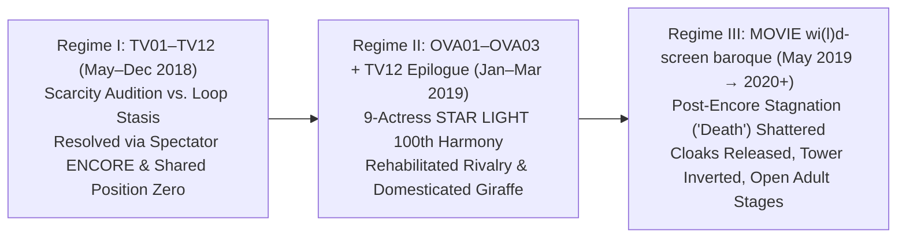

# Independent Full Animated-Corpus Synthesis: *Shōjo Kageki Revue Starlight* (`TV01`–`TV12`, `OVA01`–`OVA03`, & 2021 Theatrical Sequel)

> [!IMPORTANT]
> **Immutable Pre-Exposure Firewall Attestation (`CP16_IMMUTABLE_FREEZE`)**: This synthesis represents the complete, independently derived interpretation of the *Shōjo Kageki Revue Starlight* animated corpus (`16` source units totaling `25,842.313s` = `07:10:42.313` of native Japanese audiovisual media), produced **prior to any inspection of the published `series/revue-starlight/` corpus** in `anime-manga-ln-games-analysis`, external wikis/interviews/reviews, or *Revue Starlight -Re LIVE-* mobile-game material (`existing_corpus_exposure: false`). All prospective horizon readings (`CP01`–`CP15`) remain byte-unmodified at their respective checkpoints in accordance with strict non-erasure governance.

---

## 1. Whole-Corpus Dramatic Architecture: The Three-Regime Dialectical Spiral

Viewed across all sixteen animated source units ([TV01–TV12](../02_tv_synthesis/RS_AV_R2_TV_ONLY_SYNTHESIS.md), [OVA01–OVA03](../03_ovas/RS_AV_R2_OVA_TO_TV_SUPPLEMENT.md), and [MOVIE](../04_movie/RS_AV_R2_MOVIE_MONOGRAPH.md)), *Revue Starlight* executes a **three-regime dialectical spiral** in which the resolution of each theatrical regime generates the structural contradiction of the next:

1. **Regime I — Zero-Sum Fuel Scarcity vs. Cyclical `再演` Sanctuary (`TV01`–`TV12`, `May 14` → `December 2018`)**:
   - In `TV01`–`TV10`, two incompatible answers to theatrical finitude collide beneath Seishō Music Academy:
     - **Daiba Nana's anti-attrition `再演` loop** (`CLM-0012`, `CLM-0013`), which rewinds `2018.5.25` → `2017.4.17` across `5+` cycles so nobody drops out (`成瀬彩陽` & `逢坂`) or outgrows the `99th` Festival—at the cost of killing theatrical liveness (`届いたはずなのに… まだ、まぶしい`, `TV07` `19:04`).
     - **The Giraffe's / `THE STARLIGHT GATHERER`'s sacrificial combustion engine** (`CLM-0015`, `CLM-0017`), which harvests defeated Stage Girls' `キラめき` (`-130g` = `42.05` → `41.92 kg`, stage anesthesia + teleological amnesia) at tournament completion as `燃料` (*fuel*) for a single `トップスタァ`—culminating in Hikari's bare-palm blood sacrifice and desert self-imprisonment (`TV11` `00:40`–`01:26`, `CLM-0021`).
   - `TV11`–`TV12` (`CLM-0022`–`0025`) supersedes both traps **within the horizon of Seishō Academy**: delegated by all 7 classmates (`舞台で、待ってる`) and ejected into the `観客席` (`TV12` `16:05`), Karen seizes the spectator's (`あなた`) prerogative to demand an **`ENCORE` (`運命の舞台の再生産`)**, burns her red crown hairpin (`16:36.8`), re-fuses her shattered clasp with kintsugi seams (`18:05.6`), uncloaks Hikari onto a **shared `ポジション・ゼロ` (`21:35`)**, and expands Seishō's 8-role script into a **9-actress (`2 leads + 7 Goddesses`) `STAR LIGHT 100th`** (`23:11.6`).

2. **Regime II — Rehabilitated Ensemble Craft & Pre-Curtain Humanity (`OVA01`–`OVA03`, `January` → `Early March 2019`)**:
   - Inserting a 50-day winter-to-spring rehearsal triptych inside `TV12`'s `21:43` → `22:00` ellipsis (`CLM-0027`, `[REV-OVA01-01]`), `#1`–`#3 99.419` demonstrates what `TV12`'s victory looks like in ordinary school craft: Maya processes the sting of losing `Claire` (`悔しいですともー！！`, `OVA02` `04:13.5`) to rehabilitate **`奪う`** into healthy artistic competition (`主役を奪ってくれて`), Junna coins her own ensemble maxim (`私の言葉よ`, `06:06`), Karen trains 50 winter days against a `160 km/h` (`99.419 mi/h`) pitching machine to win a giant `Mr. White` plush for trembling Hikari (`OVA03` `00:16.5`, `04:39`), and the Giraffe shrinks to benign chalk art (`うん！ / ほしをつむ`, `ova03_0363.5`).

3. **Regime III — Post-Fulfillment "Death" & Destruction of the Closed *Starlight* Frame (`MOVIE`, `May 2019` → `2020+`)**:
   - `MOVIE` (`CLM-0029`–`0033`) asks the ruthless question `TV12` and `OVA03` could not ask while Class 99 remained sheltered inside Seishō: **what happens to Stage Girls whose entire bond was forged around performing *Starlight* together once *Starlight* has been perfected and graduation scatters them into adult reality?**
   - Two months after `100th` *Starlight* (`May 2019`), `TV12`'s shared `ポジション・ゼロ` and `OVA03`'s ensemble warmth have calcified into polite self-censorship (`Futaba`'s `お前のため`), timid retreat (`Junna`'s `大学進学`), satisfied decay (`Claudine`'s `満足して、朽ちて、死んでいく`), and **Karen's 100% blank career survey (`#1`)**. As Nana diagnoses (`00:42:05`), **「あの日、私は見たの。再演の果てに、私たちの死を。」**
   - Consequently, **`wi(l)d-screen baroque` is explicitly NOT an Audition (`これはオーディションにあらず`, `00:27:20`)**: mechanical clasp-dropping can no longer terminate a Revue (`②` at `01:08:03`; `④` at `01:36:31`) until each Stage Girl strips off borrowed/polite masks. The Giraffe **self-immolates as fuel (`舞台に火を灯すための——燃料！`, `01:30:22`–`01:31:13`)**, Karen **literally dies onstage (`01:46:29`, `-99.64 dBFS`)** and **incinerates her childhood selves/letter in the `アタシ再生産` rocket-train (`01:50:25`)**, her sword **snaps in half on its own (`01:53:43`)**, Tokyo Tower is **driven upside-down like a stake into desert `Position Zero` (`01:55:08`)**, and **all nine Revue cloaks fly free (`01:55:17`–`02:00:17`)** as `Position Zero` returns to hot-pink gaffer's tape on a real-world audition floor (`s25`).

---

## 2. Master Corpus Chronology & Continuity Audit (`Supported Recurrence vs. Retroactive Revision`)

### 2.1 Complete Reconstructed Timeline (`2006.5.14` → `2020+`)

| Era / Date Anchor | Verified Narrative Events Across Corpus | Primary Source Locators | Continuity Classification |
| :--- | :--- | :--- | :--- |
| **Pre-`2006.5.14` (Age 5)** | Timid, aimless Karen (`わかんない`) hides behind adults; poised child-actress Hikari plays Lavinia (`ラヴィニアお嬢様役`), guides Karen's kindergarten castanets, and invites Karen to theater. | `MOVIE` `00:12:10`–`00:18:16` | **Retroactive Inversion (`[REV-MOV-01]`)** of `TV` flashbacks |
| **`2006.5.14` (`13 yrs prior` to 2019)** | Karen & Hikari attend professional 9-actress `スタァライト / The Starlight Gatherer` (`s31`). Karen blazes (`行こう、あの舞台へ！`), birthing `舞台少女・愛城華恋` while planting Hikari's secret fear of becoming Karen's fan (`01:48:18`). Before moving to London, Hikari exchanges crown/star hairpins at Tokyo Tower (`私がいると、かれんすぐ甘えるから！`) and bans replies. | `TV01` `00:05`, `TV04` `00:55`, `TV08` `00:18` & `04:55`–`06:58`, `MOVIE` `00:31:00`–`00:34:24` & `00:44:00`–`00:44:35` | **Core Spine + Deepened Motive (`[REV-MOV-03]`)** |
| **`2011`–`2016` (Childhood – Jr. High)** | • `Kyoto`: Kaoruko names Futaba `ファン第一号` (`50円` → `500円`, `TV06`). • `Age 8`: Cram-school Junna sees *Starlight* (`TV02`). • `2012.3.16`: 11yo Claudine wins Best Actress for *Ally* (`天堂裕一`, `TV10` `07:33.5`). • `2013.9.23`: Jr.-high Karen (`劇団アネモネ`) confronted by Aunt `マキ` (`MOVIE` `00:49:50`). • `Jr. High`: Lonely Nana's `第七中` play (`1/10` hooks, `TV09`); Mahiru's national baton titles (`TV05`). • **`2016`**: Karen breaks `見ない・聞かない・調べない` on `KensaQooo`, reading `Hikari Kagura — Student Acting` on RADA's `2016年 合格者一覧` (`MOVIE` `s11`). | `TV02` `18:48`, `TV05` `21:38`, `TV06` `00:03`, `TV09` `05:51`, `TV10` `07:33`, `MOVIE` `00:45:02`–`00:55:03` & `01:25:41`–`01:26:45` | **Supported Baselines + Retroactive Breach (`[REV-MOV-02]`)** |
| **`2017.3.18` → `2018.5.25` (`Timeline 0` & `Loops 1..N`)** | Enrollment (`2017.4.17`); `99th` Festival (`2018.3.3`–`3.5`, `8` roles: `Maya=Claire, Claudine=Flora` + `6` Goddesses); `成瀬` & `逢坂` drop out (`2018.4.9`); `二刀流` Nana defeats Maya (`2018.5.25`, Karen `8位` dead last `TV09` `14:16`) and loops `5+` times. Parallel Spring 2018: Hikari loses London `R.A.T.A.` Audition to `Judy Knightley` (`-130g` `燃料` loss) and breaches Loop `N`. | `TV05` `05:43`, `TV06` `23:48`, `TV07` `00:02`–`21:38`, `TV08` `02:23`–`14:45`, `TV09` `07:40`–`14:22` | **Pre-Planted Loop Architecture (`TV01`–`TV09`)** |
| **`2018.5.14` → `2018.5.28` (`Loop N+1` Audition)** | Hikari (`#29`) transfers on **`5月14`** (`TV01` / `TV10` `03:55` / `MOVIE` `s12`), where Karen **feigns ignorance** (`えっ、そうなの！？`, `[REV-MOV-02]`) and plunges into the Underground Audition (`9人目`). Across Days 1–7 (`TV01`–`TV09`) and Final Day (`Sunday 2018.5.27`, `TV10`), `Karen & Hikari` defeat `Maya & Claudine`, Hikari casts Karen down the shaft (`悲劇のレヴュー`), and on **`2018.5.28`** (`TV11` `tv11_s08`) slices her palm to spare peer `燃料` and enters desert captivity. | `TV01`–`TV10`, `TV11` `00:18`–`03:45`, `MOVIE` `01:26:50`–`01:27:50` | **Locked Calendar + `MOVIE` Interior Revision** |
| **`Dec 2018` → `Early March 2019` (`ENCORE` & `100th` Festival)** | One `12 DECEMBER` 2018 night (`TV11` `16:55`–`TV12` `21:43`): Karen descends via 7-peer `舞台で、待ってる`, launches spectator `ENCORE`, uncloaks Hikari onto shared `ポジション・ゼロ` (**leaving Karen's red cloak fastened**, `TV12` `21:35`), and eats the 9-girl hotpot. Across **Jan–Feb 2019** (`OVA01` `-50d` → `OVA02` `-29d`, Karen's `99.419 mi/h` batting training), Class 99 prepares and opens **`聖翔祭 2019` (`STAR LIGHT 100th`, 9 actresses)** in **early March 2019** (`OVA03` `06:57` applause → `TV12` `22:00`–`23:49`). | `TV11` `08:15`–`24:05`, `TV12` `00:00`–`23:50`, `OVA01`–`OVA03` (`ova01_0009.5`, `0080.5`; `ova03_0016.5`, `0356.0`) | **OVA Calendar Refinement (`[REV-OVA01-01]`)** |
| **`May 2019` → `Spring 2020+` (Year 3 `wi(l)d-screen baroque` & Adult Dispersal)** | Year 3 `進路希望調査票` (`#1` Karen blank, `#29` Hikari `自主退学` in London on *Salvatore*) + `新国立` field trip trigger `wi(l)d-screen baroque` (`皆殺し` → `① 怨み` → `② 競演` → `③ 狩り` → `④ 魂` → Giraffe fireball → Karen's death, `アタシ再生産` incineration, broken sword, `私も……ひかりに、負けたくない`, inverted Tower, `8` flying cloaks). Post-graduation (`2020+`): `Maya/Mahiru/Futaba` join `新国立`, `Kaoruko` succeeds `花柳壽仙` (Kyoto), `Claudine` joins `テアトル・ドゥ・フラム` (Paris), `Junna` studies in `NY`, `Nana` studies at `王立演劇学院` (London), `Hikari` tours globally, and `#1 Karen` auditions in Tokyo as her **9th red cloak** flies free (`02:00:15.8` `s26`). | `MOVIE` `00:00:00`–`02:00:22.235` (`s01`–`s35`, `ed_sheet_1`–`3`, `k_4`–`k_6`) | **Sequel Culmination (`CLM-0029`–`0033`)** |

### 2.2 Rigorous Separation: Genuine Cross-Corpus Continuity vs. Retrospectively Imposed Coherence

Section 8 requires explicitly distinguishing continuities supported by repeated early-to-late evidence from retroactive revisions where later works reshape earlier scenes:

1. **Genuinely Supported Cross-Corpus Structural Recurrences (`[AV-FACT]` / `[FORM-REC]`)**:
   - **Karen's Unsevered Red Cloak (`TV12` `21:35` → `MOVIE` `00:03:19` & `02:00:15.8`)**: Already recorded in our pre-Movie `TV12` close reading (`EVD-TV12-VIS-03`), `TV12` `21:22`–`21:35` detached Hikari's blue `Claire` cloak while leaving Karen's red Revue cloak fastened on her shoulders—an objective visual asymmetry that `MOVIE` directly weaponizes (`Cold Open` `00:03:19` → `Post-Credits` `02:00:15.8` `s26`).
   - **Calendar Numerology (`5月14` & March Festival Cycle)**: `5月14日` anchors `2006.5.14` (`MOVIE` `s31`), `2018.5.14` (`TV07` `20:52`, `TV10` `03:55`, `MOVIE` `s12`), and Seishō's annual March `聖翔祭` (`TV07` `2018.3.3` matching `OVA01`–`OVA03`'s early-March `聖翔祭 2019`).
   - **Character Dispositional Spines**: Junna's reliance on external literary maxims (`TV02`, `TV09`, `TV10` → `OVA02` `私の言葉よ` → `MOVIE` `他人の言葉じゃ、ダメ！！`), Maya's self-confessed greed/jealousy beneath noble poise (`TV03` `20:59`, `TV04` `15:19` `強欲` → `OVA02` `04:13` → `MOVIE` `欲深い人間` / `天上天下唯我独煌`), Nana's dual identity as actress and stage-manager/director (`TV01`, `TV06`–`TV09` → `MOVIE` `新国立 俳優部/制作部` survey & `白上掛け`), and Mahiru's masked insecurity behind caretaker cheerfulness (`TV05` → `MOVIE` `私も怖かったから…演じてた`) are 100% continuous from `TV01`–`TV06` through `MOVIE`.
   - **The Giraffe as Fourth-Wall Spectator Avatar**: Planted in `TV01`'s `観客が望むなら` (`CLM-0001`), surfaced in `TV07`'s `予測できない運命の舞台` (`19:58`), made explicit in `TV12`'s `90°` camera-lens stare (`あなた`, `14:15`), and consummated in `MOVIE`'s self-immolation (`わがままで欲張りな観客…あなたたちのせい`, `01:29:46`).

2. **Retrospectively Imposed / Productive Revisions (`[REV-OVA01-01]`, `[REV-MOV-01..03]`)**:
   - **Late-December vs. Early-March `100th` Festival (`[REV-OVA01-01]`)**: `TV12` (`21:43` → `22:00`) cut directly from a December 2018 hotpot to `STAR LIGHT 100th` without seasonal markers, naturally suggesting a year-end performance until `OVA01` (`聖翔祭まで 50日` / `聖翔祭 2019`) inserted a 2.5-month Jan–Mar 2019 rehearsal span.
   - **Karen's `TV01` Ignorance vs. `2016` `KensaQooo` Knowledge (`[REV-MOV-02]`)**: Within `TV01`–`TV12` alone, zero visual or vocal cues hinted that Karen's `えっ、そうなの！？` in `TV01` was feigned or that she had searched `Hikari Kagura` online in 2016; `MOVIE` (`01:25:41`–`01:27:50` `s11`–`s12`) consciously **rewrites the subtext** of `TV01` to expose Karen's 13-year fear and single-target fixation (`見えてなかったんだ。ひかりちゃんしか`).
   - **Childhood Initiator Polarity & Hikari's Fan-Terror (`[REV-MOV-01]`, `[REV-MOV-03]`)**: `TV01`–`TV12` framed `2006` Karen as naturally outgoing and Hikari as naturally reserved; `MOVIE` (`00:12:10`–`00:18:16`, `01:48:18`) inverts their pre-*Starlight* baselines (`わかんない` Karen vs. child-actress Lavinia Hikari) and adds Hikari's fear of becoming Karen's passive fan alongside `TV08`/`TV11`'s homesickness and sacrificial guilt.

---

## 3. Heterogeneous Character Trajectories: Refusing a Single Developmental Template

A central finding of this independent reanalysis (`CLM-0031`, `CLM-0034`) is that **the nine Stage Girls of Class 99-A do NOT follow one homologous coming-of-age formula**. Across the corpus, they divide into **five structurally distinct developmental geometries**:

1. **Scaffolded Birth → Total Ego-Death & Past-Incineration → Autonomous Auditionee (`愛城華恋`, `#1`)**:
   - Unique in the cast, Karen had **no pre-existing self prior to Hikari's `2006.5.14` invitation** (`わかんない`). Throughout `TV01`–`TV12` and `OVA01`–`OVA03`, her extraordinary resilience (`飛び入り`, `二人で合格`, `ENCORE`, `99.419 mi/h` batting) drew 100% of its voltage from reaching and saving Hikari—meaning that **winning `TV12` emptied Karen of her sole teleology** (`進路希望調査票` blank). Unlike every classmate, Karen cannot simply "try harder" or unmask a hidden ambition; she must **literally die onstage (`MOVIE` `01:46:29`)** when confronted with the real audience, **burn up her childhood selves (`01:50:25`)**, let her sword snap (`01:53:43`), and start from `空っぽ` (`01:56:20`) at an open Tokyo audition (`#1`).

2. **Child Prodigy → Sacrificial Atoner → Unbound Itinerant Rival (`神楽ひかり`, `#29`)**:
   - Already a working child actress at age 5, Hikari suffers **two external/self-inflicted strippings** in `TV` (`London -130g` extraction `TV08`; `Tower` palm-blood imprisonment `TV11`) before `OVA01`–`OVA03` reveals her deadpan theater-nerd baseline and stage fright (`ぷるぷる`). In `MOVIE`, having already withdrawn from Seishō (`自主退学` `s28`), she faces not an institutional survey but her **internalized actor's cowardice** (`ファンになってしまうのが怖かった`, `01:48:18`), maturing from unilateral protector/runaway (`だから…さよなら`, `TV10`) into the equal who catches Karen's broken sword bare-handed (`01:53:54`) and roams international stages (`London → Paris → NY → Commuter rail`).

3. **Institutional Deferral / Protective Custodianship → `180°` Geographic & Existential Reversal (`星見純那` `#25` & `大場なな` `#15`)**:
   - **Junna** (`#25`, `TV02` `The Star Knows`) is the cohort's sole non-prodigy intellectual striver whose arc runs through **language ownership**: quoting others to brace herself against innate geniuses (`TV02`, `TV09`) → tentatively coining an ensemble motto (`私の言葉よ`, `OVA02`) → retreating to `大学進学` in Year 3 (`今は敵わない`) → **violently abjuring borrowed quotes (`他人の言葉じゃ、ダメ！！`, `MOVIE` `01:20:09`)**, stepping off her `バミリ` (`s10`), defeating `二刀流` Nana, and leaping straight to **New York's `NYミュージカル＆ドラマアカデミー`**.
   - **Nana** (`#15`, `TV06`–`TV09`) moves from **maternal loop-jailer** (`第99回聖翔祭の再演`) → healed finite participant (`いつか終わるからこそ`, `TV11` `20:03`) → **merciless post-`再演` diagnostician** (`皆殺しのレヴュー`, `白上掛け`) who orchestrates her own symbolic death (`00:42:13`) and gifts Junna her wakizashi (`01:19:06`) so Junna can end her custodial `再演` forever—freeing Nana to leave Seishō/`新国立` behind for **London's `王立演劇学院`** (`ed_sheet_3`).

4. **Pinnacle Perfectionism / Prodigy Pride → Unmasked Human Greed & Cross-Continental Rivalry (`天堂真矢` `#18` & `西條クロディーヌ` `#11`)**:
   - Neither Maya nor Claudine ever wavers in her institutional destination (`新国立` and Paris `テアトル・ドゥ・フラム`). Instead, their trajectory transforms **the metaphysics of excellence**:
     - **Maya** descends from solitary `トップスタァ` isolation (`TV03` vocal eviction) through her first defeat + French vulnerability (`TV10`) and cathartic `悔しいですともー！！` (`OVA02` `04:13.5`), yet still hides in Year 3 behind a pretentious "empty vessel of the gods" (`神の器`) persona—until Claudine decapitates her iron Bird (`MOVIE` `01:38:35`, paired with Maya's `0`-win Animal Shōgi ineptitude `s13`), liberating Maya's ferocious human greed (`天上天下唯我独煌`, `私は、いつだって可愛い！！`).
     - **Claudine** evolves from humbled Franco-Japanese child prodigy (`TV03`/`TV10`) who tears off her own unbroken cloak to protect `"Ma Maya"` (`TV10` `19:11`) into the **active philosophical challenger** of `MOVIE` (`01:28:52`), refusing satisfied stagnation and winning Maya's *Faust* confession (`西條クロディーヌ…あなたは、美しい`, `01:42:00`).

5. **Caretaker / Hierarchical Symbiosis → Self-Possessed Craft (`露崎まひる` `#17`, `石動双葉` `#2`, & `花柳香子` `#22`)**:
   - **Mahiru** (`#17`) executes perhaps the sharpest genre-inversion in the corpus: from `TV05`'s self-erasing dorm mother begging Karen to stay helpless (`お寝坊してよ`) → `OVA03`'s `150 km/h` slugger → `MOVIE`'s **terrifying backstage slasher-actress** (`どうして演技しないの？`, `01:08:20`) who integrates rather than conquers stage fright (`今も、まだ怖いよ…決めたから。舞台で生きていくって`, `01:12:30`) to enter `新国立` alongside Maya.
   - **Futaba & Kaoruko** (`#2` & `#22`) invert `TV06`'s reconciliation: in `TV06`, Futaba stopped Kaoruko from quitting Seishō so they could walk one merged `一本道` (`やがては一本道に`); in `MOVIE`, graduation *requires* their paths to split (`Tokyo` vs. `Kyoto`), so Kaoruko destroys Futaba's noble `お前のため` excuse (`00:59:06`) until Futaba claims childish selfishness (`わがまま言う番`, `01:03:38`) and Kaoruko converts her inherited Kyoto `花柳壽仙` succession into an active bid to surpass Tokyo from afar (`帰るんやなくて、始めよかな`, `01:04:08`).

---

## 4. Directed-Relationship Matrix Across Corpus Horizons (`A → B` vs. `B → A`)

| Directed Pair | `TV01`–`TV06` Asymmetry | `TV07`–`TV12` & `OVA` Shift | `MOVIE` Final Equilibrium (`2020+`) |
| :--- | :--- | :--- | :--- |
| **`Karen → Hikari`** | Unconditional pursuit (`二人で合格`), feigning ignorance of RADA (`[REV-MOV-02]`) | Self-burning `ENCORE` rescuer (`ひかりちゃんを私に全部ちょうだい`, `TV12`); `160 km/h` plush giver (`OVA03`) | Burns nostalgic past; drops `-ちゃん` (**`私も……ひかりに、負けたくない`**); autonomous rival (`ゴメン！！ 今日 オーディション！`) |
| **`Hikari → Karen`** | Deterrent protector (`あの子は邪魔よ`, slap) hiding Audition penalty + fan-terror | Self-sacrificing `悲劇のレヴュー` slasher & palm-blood prisoner (`TV10`–`TV11`) → grateful `100th` co-lead (`OVA02`–`03`) | Prompts Karen's ego-death (`01:45:02`), writes 2nd letter, catches broken sword bare-handed (`01:53:54`), sends `去れ。` sticker |
| **`Maya → Claudine`** | Imperious dismissal (`手を抜いた覚えはありません`, `TV03`), secretly driven by jealousy (`TV04`) | Steps into French (`Ma Claudine`) & clasps hand (`TV10` `20:36.5`); hides behind `神の器` | Unmasked greedy rival; speaks *Faust*'s **`あなたは、美しい`** (`01:42:00`); eternal Tokyo–Paris duel |
| **`Claudine → Maya`** | Obsessive benchmark (`TV02`–`TV03` rejected handshake) | Tears off own unbroken cloak (`TV10` `19:11`) to shield `"her Maya"`; relaxed banter (`OVA03`) | Checkmate-dominant at shōgi; decapitates iron Bird (`欲深い人間よ！！`), pierces `T` contract (`01:41:43`) |
| **`Junna → Nana`** | Warm senpai-like roommate reliance (`ばなナイス`) | Rejects static `再演` (`全部持っていってあげて`, `TV09`); coins `私の言葉よ` (`OVA02`) | Rejects past-tense elegy & borrowed quotes; grips Nana's wakizashi to defeat Nana & leap to `NY` |
| **`Nana → Junna`** | Maternal shelter (`星光館` cook/counselor) | Accepts finitude (`TV09`–`TV11`); teasing Hesse banter (`TV10`) | Stages `切腹` shock therapy & **gifts own wakizashi** (`01:19:06`) so Junna ends her `再演` → `London` |
| **`Futaba → Kaoruko`** | Lifelong attendant (`50円`→`500円`), secret solo tapping (`TV06`) | Blocks self-severing (`TV06` `19:45`); `世界一` stretch/snack enforcer (`OVA03`) | Drops `お前のため` mask for raw **`わがまま言う番`** (`01:03:38`); rides gifted `TONDA` bike to `新国立` |
| **`Kaoruko → Futaba`** | Exploitative aristocratic dependency (`TV06`) | Vows self-reliance (`負けまへん`); playful `文句の割に♪` (`OVA03`) | Cuts BGM on pious excuse (`本音さらせや`), jumps `清水の舞台`, gifts `TONDA` key, vows Kyoto `#1` |
| **`Mahiru → Karen / Hikari`** | Codependent caretaker (`TV05` `お世話焼かせてよ`) & intimidation toward Hikari | Restored emerald autonomy (`TV05` ED); English phone cards (`TV11`); baton hand-warming (`OVA03`) | Confronts Hikari one-on-one as terrifying `本物の舞台女優`, shares fear, gifts Gold Medal (`01:13:48`) |
| **`Giraffe ↔ Stage Girls / Viewer`** | Cryptic tournament host (`わかります`) harvesting `-130g` `燃料` (`TV08`) | Stares `90°` at viewer **`あなた`** (`TV12` `14:15`); domesticated chalk doodle (`OVA03`) | Edible **`野菜キリン`** (`s33`) → **self-immolates as fireball `燃料`** (`あなたたちのせい`, `01:29:46`–`01:31:13`) |

---

## 5. Japanese Speech, Address-Register Evolution, & Textual Witness Audit

### 5.1 Corpus-Wide Address & Register Transformations
Tracking spoken Japanese across all `16` units (`EVD-TV01..12-LNG`, `EVD-OVA-LNG`, `EVD-MOV-LNG`) demonstrates that **shifts in honorifics, pronouns, and `口上` syntax index structural character turning points**:
1. **The Hikari Address Network**:
   - **Karen → Hikari**: Calls her **`ひかりちゃん`** across `100%` of `TV01`–`TV12`, `OVA01`–`OVA03`, and the first `113` minutes of `MOVIE`—until `01:54:13` (`最後のセリフ`), when she drops `-ちゃん` for the **only time in the animated corpus**: **`「私も……ひかりに、負けたくない。」`**
   - **Classmates → Hikari**: Begins in `TV01`–`TV04` as distant `神楽さん` / `神楽`; shifts in `OVA01` (`06:26`) when Futaba initiates mutual **`ひかり` / `双葉`**, in `OVA02` (`06:12`) when Hikari first addresses **`星見さん`**, and in `OVA03` (`02:41`, `02:56`) where Claudine uses bare **`ひかり`** and Kaoruko uses Kyoto **`神楽はん`**, culminating in Mahiru & Hikari's mutual bare **`ひかり` / `まひる`** in `MOVIE` (`01:14:08`).
2. **Evolution of the `口上` (*Nanori*)**:
   - In `TV01`–`TV10`, every combatant enters with a standardized institutional formula (`出席番号X番、[Name] — 煌めく舞台に…`).
   - In `MOVIE`, `wi(l)d-screen baroque` **shatters standardized `口上` into raw, character-specific declarations of ego**: Junna's **`足掻いて、もがいて、主役を喰らう！99代生徒会長、星見純那！殺してみせろよ——大場なな！！`** (`01:20:16`), Maya's **`輝くチャンスは不平等！ちぎって喰らえ共演者！愛も自由も敗者の戯言！天上天下唯我独煌！`** (`01:39:05`), Karen & Hikari's singular declarations (`愛城華恋は、舞台に一人！` / `舞台の上にスタァは一人！`, `01:52:06`–`01:52:45`), and finally Candidate `#1`'s unadorned real-world **`エントリーナンバー1番、愛城華恋。よろしくお願いします！`** (`02:00:11`).
3. **Bilingual & Literary Code-Switching**:
   - **Claudine & Maya's French**: Reflexive spikes under shock in `TV01`–`TV08` (`C'est pas vrai!`, `Mon Dieu!`) mature in `TV10` (`19:42`–`20:28`) into a `65s` uncaptioned French duet of mutual recognition (`Ma Maya à moi` ↔ `Ma Claudine`), followed by relaxed `OVA03` (`Comment?`, `Faisons de notre mieux!`).
   - **Literary Intertexts**: *Hyakunin Isshu* #77 (`TV06` `20:15` vs. inverted `ここが別れの一本道` in `MOVIE` `00:57:45`), Shakespeare's *Romeo and Juliet* I.v (`TV08` `03:08`), English `THE STARLIGHT GATHERER` (`TV09` `05:34`, `TV11` `15:16`), Yosano Akiko's *Kimi Shinitamō Koto Nakare* + Goethe/Nietzsche/Hesse/Shaw/Socrates/Confucius (`MOVIE` `01:15:34`–`01:20:09`), and Goethe's *Faust* (`MOVIE` `01:31:31`–`01:42:03`: `西條クロディーヌ…あなたは、美しい`).

### 5.2 Complete Three-Tier Subtitle/Transcript Reliability Audit
| Sub-Corpus | Auxiliary Text Witness Provenance | Verified Defects vs. Primary Lossless/Original Japanese Audio (`0:a:0`) |
| :--- | :--- | :--- |
| **`TV01`–`TV12`** | Broadcast Japanese closed-caption `.ass` (`s01e01..12.analysis.ass`) | • Omits **100% of uncaptioned Revue vocal-allocation counterpoints** (`TV02` `20:15`, `TV03` `18:33` eviction, `TV09` `18:00` post-slash duet) & `TV10`'s `65s` French dialogue. • **`+58.30s` commercial-break timestamp drift** in `s01e10.analysis.ass` lines `291–302` (`22:38.82` vs. true `21:40.5`). • **Two outright lyric transcription errors**: `TV03` line 267 (`より強く` → sung **`より高く`**); `TV12` line 256 (`星は` → sung **`君は`** at `20:37.7`). |
| **`OVA01`–`OVA03`** | **0% Japanese subtitle tracks** (English-only fansubs in `01_subtitles/`) | • Required **100% pure Japanese listening** from `48 kHz / 24-bit` FLAC + `1920x1080` visual signage (`聖翔祭 2019`, `99.419 mi/h`); uncertain rapid syllables in `OVA02` `05:35` explicitly bracketed `[聴取不確定]`. |
| **`MOVIE` (2021)** | Community fan transcription (`[1691]`: *"jp transcribed by 1computer on discord (very low on sleep)"*, seiyū nickname styles) | • Cue `[0363]` (`次の駅を`) & `[0398]` (`次の駅`) mis-transcribe sung/spoken **`列車は必ず次の駅へ`**. • Cue `[0951]` prints singular `うちは` where Kaoruko sings plural **`うちら`** (`うちらあんたに勝たれへん`). • Omits English stage dialogue (`00:19:40` `Yes, I see`) and all `1920x1080` playbill/career/credit typography (`前奏作曲：本多友紀`, unified `スーパー スタァ スペクタクル`). |

---

## 6. Cross-Corpus Musical Dramaturgy & Multimodal Spatial Ontology

Across `TV01`–`TV12`, `OVA01`–`OVA03`, and `MOVIE`, music and spatial sound design operate not as emotional accompaniment, but as **structural state-machines and ontological boundaries** (`CLM-0002`, `CLM-0004`, `CLM-0005`, `CLM-0008`, `CLM-0010`, `CLM-0018`, `CLM-0020`, `CLM-0022`, `CLM-0024`, `CLM-0026`, `CLM-0033`):

1. **Revue Vocal Topology as Real-Time Dramatic Argumentation**:
   - **Melodic Appropriation (`TV01` 「世界を灰にするまで」)**: Karen restarts the ruptured song on Junna's exact pre-chorus melody (`譲れない夢なら私にも`, `21:40.5`).
   - **Antiphonal Rescue (`TV02` 「The Star Knows」)**: `135s` of isolated Junna solo broken at the exact mannequin-slash frame (`20:14.6`) by Karen's antiphonal `分からないからこそ`, followed by `87s` of **music-free ED silence** (`22:32`–`23:59`).
   - **Structural Vocal Eviction (`TV03` 「誇りと驕り」 & `TV08` 「RE:CREATE」)**: Rank `①` Maya (`TV03` `18:33`–`20:45`) and reborn Hikari (`TV08`) evict their opponent from the vocal track completely.
   - **Non-Evictive Post-Slash Duet (`TV09` 「星々の絆」)**: Drops `-19.20 dB` across the clasp chime (`17:57.0` → `17:59.5`) so **defeated Nana and victorious Karen sing the post-slash coda together in harmony** (`繋がったの 星の絆`, `18:00`–`18:12`).
   - **Musical False Finale & Refusal of Song (`TV10`)**: 「-Star Divine- フィナーレ」 (`14:52`–`18:55`, `-15.25 dBFS`) sets up a triumphant climax violently subverted when **`悲劇のレヴュー` (`20:54`–`22:31`) refuses all singing**, ending in `11.0s` of abyssal wind and `-94.81 dBFS` silence.
   - **Chamber Threshold Counterpoint (`TV11`)**: Half-tempo `D♭` major 「舞台少女心得 幕間」 (`~70 BPM`, arranged by Katō Tatsuya) layers **7 spoken `舞台で、待ってる` monologues over 8-voice singing**, paired with a **7-voice ED excluding Karen & Hikari**.
   - **Multi-Composer Genre Unmasking & Unified Finale Suite (`MOVIE`)**: Five distinct composers (`三好啓太`, `谷ナオキ`, `広川恵一/高橋邦幸`, `佐藤純一/矢野達也/小高光太郎`, `藤澤慶昌`) score `wi(l)d-screen baroque`'s genre collisions (`#1` stereo peak **`-9.88 dBFS`** at `01:18:01.0` in `ペン：力：刀`), culminating in **Katō Tatsuya's single continuous ~8-minute four-movement suite 「スーパー スタァ スペクタクル」 (`01:48:27`–`01:56:15`)**—whose Movement II (`アタシ再生産`, `-11.00 dBFS`) absorbs and rewrites `星のダイアローグ`'s cadence before Movement IV (`-9.96 dBFS`) shears Tokyo Tower—and **`「私たちはもう舞台の上」` (`前奏作曲：本多友紀 × 作曲・編曲：佐藤純一`)**, which grafts TV OP 「星のダイアローグ」's brass fanfare onto a 9-voice graduation relay!

2. **From TV's Four-Channel ED State-Machine to `MOVIE`'s `5.1` Surround Spatial Ontology**:
   - In `TV03`–`TV12`, ED **「Fly Me to the Star」** mutates across **three distinct instrumental recordings** (`Stem I` Jazz-Swing `TV03`–`04`; `Stem II` Bossa-Pop `TV05`–`07`, reused a 3rd time in `TV07` with **human vocals erased** for solo violin + empty script spotlight!; `Stem III` Katō Strings `TV08`–`11` climbing `1 → 2 → 2 → 7` voices) before retiring in `TV12` for full 9-voice **「星のダイアローグ」**.
   - In `MOVIE` (`0:a:1`, `7,222` `1s` 6-channel bins), the **`5.1` surround and `LFE` subwoofer stems** enact the ontological boundary between fantasy spectacle and real-world craft:
     - Rear-surround balance (`Surr − Front`) surges **`+7.13 dB`** (`-9.38` → **`-2.25 dB`**) the instant Mahiru turns from Olympic pop into a backstage horror actress (`01:08:09`).
     - Karen's onstage death (`01:46:32.50`) drops to **`-99.64 dBFS` digital zero**, isolating Hikari's sobs **`+17.25 dB` in dry `FC`**.
     - Tower shearing (`01:54:18`–`01:55:45`) hits **`-17.03 dBFS` mean / `-10.83 dBFS LFE` peak** (`Surr − Front = -2.34 dB`); then, at **`01:57:06`, `LFE` shuts off completely (`-96.00 dBFS` to EOF)**, and Post-Credits **`本日、今 この時`** (`01:59:56`–`02:00:18`) collapses **`+25.10 dB` into dry `FC`** (`-29.30 dBFS` vs. `-54.38 dBFS` `FL/FR`), placing `#1 愛城華恋` in naked, unamplified room acoustics.

---

## 7. Visual/Theatrical Form, Competing Macro-Readings, & `[OPEN]` Evidentiary Limits

### 7.1 Five Cross-Corpus Metamorphic Signifiers
1. **Aspect Ratio (`16:9` → `80s` `2.35:1` → Constant `2.388:1` CinemaScope)**: `TV` and `OVA` inhabit `1.778:1` (`16:9`), widening **once** for `80s` during `TV12`'s sunrise uncloaking (`19:46`–`21:06`); `MOVIE` locks `100%` of its `7,222s` runtime to **`1920x804` (`2.388:1` `crop=1920:804:0:138`)**, turning the theatrical frame itself into **`wi(l)d-screen baroque`**.
2. **`ポジション・ゼロ` (`T` / `バミリ`)**: Coveted apex (`TV01`–`TV10` `This is 天堂真矢`) → sheared in half (`TV12` `15:37.6`) → shared horizontal bed (`TV12` `21:35`) → **stepped past by Junna's emerald boot** (`MOVIE` `01:22:31.5` `s10`) → **pierced & impaled upside-down by sheared Tokyo Tower** (`MOVIE` `01:55:08` `s23`) → **ordinary hot-pink gaffer's tape on a wooden audition floor** (`MOVIE` `02:00:01.5` `s25`).
3. **`燃料` (*Fuel*)**: `-130g` stolen peer `キラめき` (`TV08`) → Hikari's bare-palm blood (`TV11`) → Karen's red crown hairpin (`TV12`) → **exploding/bitten red tomatoes & Arcimboldo `野菜キリン`** (`MOVIE` `00:41:55` `s33`) → **the Giraffe self-immolating as a fireball** (`01:30:22`–`01:31:13`) & **Karen burning her own childhood past** (`01:50:25`).
4. **Clasps, Weapons, & `9` Cloaks**: Mechanical clasp loss (`TV01`–`TV10`) → shattered/kintsugi re-fused clasp (`TV12` `18:05.6`) → **clasp-drop unable to end insincere Revues** (`MOVIE` `01:08:03`, `01:36:31`), gifted weapons (`TONDA` key, Gold Medal, Nana's wakizashi), **Karen's self-snapping rapier (`01:53:43`)**, and **all `9` Revue cloaks flying free into the blue sky (`01:55:17`–`02:00:17` `s26`)**.
5. **Tokyo Tower**: Childhood hairpin shop (`TV08` `06:41`) → nested playground slide (`TV04` `18:12`) → Star-Picking abyss (`TV10` `22:14`) → toppled desert ruin (`TV11` `23:57`) → horizontal `✧ 約束タワーブリッジ ♔` (`TV12` `18:29`) → **sheared and driven point-down into desert `Position Zero`** (`MOVIE` `01:55:08` `s23`).

### 7.2 Weighing Three Competing Macro-Thematic Readings
1. **Reading A — Meta-Critical Critique of Spectator/Idol Consumption (`Giraffe = Otaku/Audience Scarcity Engine`)**:
   - *Strengths*: Directly anchored in the Giraffe's fourth-wall lens stares (`TV12` `14:15` `あなた`), `MOVIE`'s `わがままで欲張りな観客…あなたたちのせい` (`01:29:46`), `TV07`'s critique of nostalgic loop rewatching (`再演`), and `MOVIE`'s destruction of the *Starlight* IP cage so the heroines enter working adult theater.
   - *Counterevidence / Limits*: If the Giraffe were merely a villainous parasite, `TV12` would punish rather than delight him (`これこそ私が見たかった舞台！`, `18:35`), `OVA03` would not affectionately doodle him on Class 99's blackboard (`ova03_0363.5`), and `MOVIE` would not show him **willingly burning himself up as `燃料`** (`01:30:22`–`01:31:13`) while cutting to the Stage Girls whose own brilliance seduces spectators (`01:29:58`).
2. **Reading B — Purely Psychological / Metaphorical Coming-of-Age Interiority**:
   - *Strengths*: Explains why `MOVIE` Stage Girls taste corn-syrup stage blood (`…甘い`, `00:30:57`), wake unscathed after "dying," and resolve real Year 3 `進路希望調査票` anxieties.
   - *Counterevidence / Limits*: Cannot reduce the Underground stages to mere subjective daydreaming without contradicting physical cross-domain traces: Hikari's `-0.13 kg` scale reading (`TV08` `09:40.5`), the Giraffe's crimson hanko on official school `退学届` paperwork (`TV11` `03:39.0`), cell-signal routing (`TV11` `21:39.5`), and all seven girls sharing simultaneous cross-stage collisions (`TV05` `15:48`–`17:38`, `MOVIE` `00:24:22`).
3. **Synthesized Independent Conclusion (`CLM-0034` — Bidirectional Theatrical Vitalism & Dual Ontology)**:
   - *Revue Starlight* sustains a **deliberately irreducible dual ontology** (`literal within theatrical space, metatheatrical in causal law`) to argue that **live performance is an inherently dangerous, finite, reciprocal combustion between greedy performers and greedy spectators**. In `TV01`–`TV12`, Stage Girls transform tragedy from within by seizing spectator `ENCORE` (`運命の舞台の再生産`); in `MOVIE`, they outgrow even that shared sanctuary—burning nostalgia, spectator fixation, and sacred `Position Zero` alike so theater can continue as open, frightening, unscripted adult craft (`本日、今 この時`).

### 7.3 Preserved `[OPEN]` Evidentiary Boundaries (`[OPEN-MOV-01]`)
- **Unresolved Title/Role of Karen's Final Audition (`01:59:56`–`02:00:18` `s25`)**: Intentionally withheld by the film (`次の舞台、次の役`).
- **Above-Ground Administrative Mechanics of Hikari's Reinstatement (`TV12`) vs. Year 3 `[自主退学]` (`MOVIE` `s28`)**: Between `TV11` (`2018.5.28` `退学届`), `OVA01`–`03`/`TV12` (`March 2019` `STAR LIGHT 100th`), and `MOVIE` (`May 2019` `#29 [自主退学]` acting in London), the anime never depicts the mundane school-office paperwork by which Hikari performed in March 2019 and returned to London by May 2019—treating the Giraffe's institutional seal (`tv11_s09`) as sufficient bridge.
- **Strict Non-Importation of Non-Anime Lore**: Whether *Revue Starlight -Re LIVE-*, stage plays (`#1`/`#2`/`#3`), or prequel manga elaborate on `Judy Knightley`, Seishō Class B, or post-graduation troupes lies strictly outside this animated corpus and is left untouched.

---

## 8. Anime-Scoped Deferred Character-Reconstruction Preservation Guide (§12 Compliance)

> [!NOTE]
> **Governance Guardrail (§12)**: Per `CHARACTER_RECONSTRUCTION_MAINTENANCE.md` and Section 12 of the assignment, this section **collects and structures anime-verified behavioral evidence** to support a potential future anime-scoped reconstruction specification, **without creating simulation prompts, without assigning any reconstruction capability tier** (reserved strictly for the independent evaluator/registry workflow), and **with zero *Revue Starlight -Re LIVE-* mobile-game material**.

| Stage Girl | Ordinary-Life Baseline (`TV` + `OVA` + `MOVIE`) | Conditional Decision Rule Under Stress | Japanese Speech & Register Locks | Performance Persona vs. Everyday Self | Negative Evidence / Anti-Flanderization Guards |
| :--- | :--- | :--- | :--- | :--- | :--- |
| **`愛城華恋` (`#1`)** | Chronic oversleeper (`TV01`/`02`/`05`), tactile puppy-like warmth (`うぱるぱ`, loves Sagano tofu, `KANI ♥`), earnest `素振り` grinder (`OVA01`–`03`), tongue-tied on formal kanji (`しゅー…集大成`). | Plunges physically toward isolated/imperiled partner before calculating rules (`TV01`, `TV11` crowbar); **freezes into blank paralysis** when deprived of relational target (`TV11` `10:24`, `MOVIE` `#1` blank survey) until reborn as self-propelled rival. | `私` / `アタシ再生産`; `-ちゃん` (`ひかりちゃん`, `純那ちゃん`, `まひるちゃん`, `ななちゃん`), **`真矢様`**, **`クロちゃん`**, **`双葉ちゃん`**, **`香子ちゃん`**; drops `-ちゃん` **only once** (`ひかりに、負けたくない`, `MOVIE` `01:54:13`); playful `ノンノンだよ`. | Everyday goofy/sleepy warmth vs. incandescent, improvisational stage physicality & post-`MOVIE` crisp professional poise (`エントリーナンバー1番`). | **Not** naturally fearless or exhibitionist from birth (`5yo` `わかんない` `[REV-MOV-01]`; `2016` secret `KensaQooo` fear `[REV-MOV-02]`; `MOVIE` `01:45:25` acute stage terror). |
| **`神楽ひかり` (`#29`)** | Quiet `マイペース` cadence, `猫舌` (hates hot tofu `TV12`), loves `Mr. White` & melon bread, `90s`-delayed social indexing + `46s` theater-history info-dumps (`OVA01`), dry deadpan teasing (`冗談`). | Defaults to **unilateral secretive self-sacrifice or flight** (`TV03` shed, `TV10` `さよなら`, `TV11` palm-slice, `MOVIE` London flight) whenever she fears harming Karen or becoming Karen's passive fan—broken only by direct confrontation (`Mahiru` `MOVIE`, `Karen` `TV12`/`MOVIE`). | `私`; bare **`華恋`** (never `-ちゃん`), polite `-さん` (`星見さん`, `露崎さん` → bare `双葉`/`まひる` in `OVA`/`MOVIE`); terse sentence endings (`…以上`, `どんと来い`, `超大丈夫`); crisp English (`Yes, I see`). | Cool, lethal `Claire`/tragic gravitas onstage vs. socially delayed, `ぷるぷる` stage-frightened (`OVA03`), dryly humorous everyday girl. | **Not** cold or emotionless: bans letters out of homesickness (`TV08`) and flees out of fierce actor's pride (`ファンになってしまうのが怖かった`, `MOVIE` `01:48:18`). |
| **`天堂真矢` (`#18`)** | Disciplined solo dorm resident, upright posture, meticulous tea/stretching, **`0` wins at children's Animal Shōgi** (`MOVIE` `s13`), warmly appreciative of Karen's backstage atmosphere (`OVA03` `05:33`). | Meets peer threat with overwhelming technical dominance (`TV03`) or aloof `神の器` detachment (`MOVIE` `ACT II`), yet **cracks into raw, greedy ferocity** when Claudine or `Claire`-loss exposes her jealousy (`TV03` `20:59`, `OVA02` `04:13`, `MOVIE` `01:39:05`). | Formal **`私（わたくし／わたし）`**, polite `です/ます` + surname-`さん` (`愛城さん`, `星見さん`) for all peers **except** bare **`クロディーヌ`** (and French `Ma Claudine` in `TV10`); signature **`This is 天堂真矢`**. | Untouchable sovereign `トップスタァ` / `神の器` mask vs. intensely jealous, greedy (`強欲`), shōgi-inept, cute-proud (`私は、いつだって可愛い！！`) human rival. | **Not** effortlessly serene or above emotion: screams `うわあああああっ！！ 悔しいですともー！！` (`OVA02`) and suffered real backstage thumbtack sabotage (`靴に画鋲`). |
| **`西條クロディーヌ` (`#11`)** | Hardworking Franco-Japanese dorm mate, generous coach (`TV06` Futaba tap, `MOVIE` `新国立` encouragement), disciplined shōgi strategist (`5-chick phalanx` `s13`), expressive reactions. | Refuses pity or unearned victory (`TV03` rejected handshake); **prioritizes protecting/unmasking Maya's true stature over nominal scoreboard wins** (`TV10` manual cloak tear; `MOVIE` Bird decapitation). | `私` / rough **`あんた`** (to Maya/Futaba/Kaoruko); bare **`真矢`**, **`華恋`**, **`ひかり`** (`OVA03`); involuntary **French** exclamations (`C'est pas vrai!`, `Mon Dieu!`, `Comment?`) & tender French intimacy (`Ma Maya`). | Fiery, aristocratic challenger/Devil onstage vs. warm, sisterly, grounded realist offstage (`お腹すいた / J'ai faim`). | **Not** an arrogant bully: humbled at age 15 (`TV10` `07:05`), openly self-critical of complacency (`満足して、朽ちて、死んでいく`, `MOVIE` `01:28:52`). |
| **`大場なな` (`#15`)** | Warm `星光館` cook/baker (`ばななマフィン`, steamed cakes, hotpot), photography/stage-craft enthusiast, observant listener (`みんな`). | Protects treasured ensemble bonds at extreme cost—first via **secret cyclical rewind (`TV07`)**, then via **ruthless shock-therapy direction (`MOVIE` `皆殺し` & `狩り`)**, willingly sacrificing her own role (`00:42:13`, wakizashi gift) once peers can stand alone. | Soft maternal `私`, `-ちゃん` (`純那ちゃん`, `華恋ちゃん`, `ひかりちゃん`), signature **`ばなナイス！`**, dropping into **icy, flat declarative pitch** (`これはオーディションにあらず`; `響かない。感じない。届かない！`) in directorial/combat mode. | Gentle "Banana" dorm mother vs. `二刀流` martial terror & unsentimental theatrical auteur (`白上掛け`). | **Not** anti-creative even inside her loops: tweaked lines/staging across `再演` cycles (`TV09` `20:40`) and ultimately chooses solo overseas study in **London** (`MOVIE` `ed_sheet_3`). |
| **`星見純那` (`#25`)** | Earnest Class 99-A representative (`学級委員` / `生徒会長`), glasses (`眼鏡`), late-night studier, herbal-tea brewer (`私スペシャル` `OVA03`), notebook highlighter. | Under inferiority pressure, **armors herself in canonical literary/philosophical quotations** (`TV02`, `MOVIE` `01:16:58`) or safe `大学進学` (`MOVIE` `00:09:20`)—until pushed past pride to **discard borrowed authority (`他人の言葉じゃ、ダメ！！`)** and leap into the unknown (`NY`). | Crisp standard `私`, surname/given-name mix (`華恋`, `なな`, `神楽さん`, `真矢さん`, `露崎さん`), earnest explanatory `-わよ / -なのよ`; raw imperative `口上` (`主役を喰らう！殺してみせろよ！`) when unmasked. | Polished intellectual archer/orator vs. glasses-less, scraping, fiercely ambitious improviser (`バミリ` stepper `s10`). | **Not** a passive bookworm or permanent supporting player: reverses `大学進学` `180°` to pursue Broadway musical conservatory training (`MOVIE` `k_5`–`k_6`). |
| **`露崎まひる` (`#17`)** | Early-rising Room `203` caretaker, cleaner, cook, Hokkaido farm family (`いいもの どっさりTV`), elite Two-Baton & `150 km/h` batting athlete (`TV05`, `OVA03`), doodler (`うぱるぱ`). | In `TV01`–`TV05`, converts self-doubt into **clingy caretaker codependency**; post-`TV05`, **channels lifelong fear (`今も、まだ怖いよ`) directly into fearless, even menacing stage acting** (`MOVIE` `競演のレヴュー`). | Soft high-pitched `私`, **`華恋ちゃん`**, **`ひかりちゃん` → `ひかり`** (`MOVIE` `01:13:48`); capable of **bone-chilling deadpan drop** (`どうして演技しないの？` / `嘘つき。下手くそ！`) onstage. | Sunny, domestic green-apron roommate vs. relentless physical baton/athletic powerhouse & psychological horror actress (`本物の舞台女優`). | **Not** weak or untalented (`全日本`/`国際` baton champion), and post-`TV05` **never** reverts to romantic/caretaker jealousy over Karen (`MOVIE` `01:12:14`). |
| **`石動双葉` (`#2`)** | Gruff, pint-sized (`#1` shortest `OVA01`) motorbike/stretch enthusiast, devoted attendant carrying Kaoruko's luggage/cleaning her room (`TV06`), secret solo practicer. | Suppresses own ambition behind **`お前のため` duty** (`TV06`, `MOVIE` `00:58:55`) until Kaoruko threatens self-sabotage (`TV06` `19:45`) or skewers her excuse (`MOVIE` `00:59:06`), releasing blunt, childish selfishness (`わがまま言う番`). | Boyish **`あたし`**, rough **`お前` / `香子`**, **`ひかり`** (`OVA01`), blunt `〜だろ / 〜じゃねえか`; drops to raw tantrum (`ずるい、ずるい！！`) in `MOVIE` `01:01:52`. | Boisterous biker/halberd brawler onstage vs. dutiful, slightly overprotective (`過保護が加速`, `OVA03`) everyday partner. | **Not** content as Kaoruko's permanent shadow: writes `新国立第一歌劇団` `>50` times on her survey and leaves Kaoruko behind in Tokyo (`MOVIE`). |
| **`花柳香子` (`#22`)** | Langorous Kyoto `千華流` Nihon-buyō heiress, sweet-tooth lounger, shrewd social observer (`TV06`, `OVA03`), calculator of hidden effort. | Masks fear of abandonment or effort behind **lazy `しょうもな` withdrawal** (`TV06` bus to Kyoto; `MOVIE` passive succession) unless provoked into lethal pride, yet **actively liberates Futaba** (`MOVIE` `00:59:06`–`01:04:35`) even when it costs her Futaba's daily care. | Soft melodious **Kyoto `京言葉`**: **`うち`** (plural `うちら`), **`あんた`** / **`双葉`**, `-はん` (`真矢はん`, `クロはん`, `純那はん`, `ななはん`, `神楽はん`), `-どす / -え / -はる` — sharpening into cold yakuza `仁義` register when angered (`表出ろや`). | Seductive, razor-tongued `花柳丸` / naginata courtesan-boss onstage vs. sleepy, snack-hoarding, secretly doting strategist offstage. | **Not** genuinely lazy or artistically resigned: masters Western song/dance at Seishō and turns Kyoto `花柳壽仙` succession into a secret campaign for `#1` (`双葉にはナイショやで！`). |

---

## 9. Full-Corpus Synthesis Claims (`RS-AV-R2-GEMINI-CARBON-CLM-0034` & `CLM-0035`)

### `RS-AV-R2-GEMINI-CARBON-CLM-0034` (Origin Horizon: `FULL_SYNTHESIS`)
- **Statement**: Across all sixteen animated units (`25,842.313s`), *Shōjo Kageki Revue Starlight* executes a **three-regime dialectical supersession** (`TV` Audition/Loop → `OVA` `100th` Ensemble Harmony → `MOVIE` `wi(l)d-screen baroque` Dispersal) that **refuses uniform character arcs**: while `TV12` and `OVA01`–`OVA03` resolve scarcity (`燃料`) and stasis (`再演`) inside Seishō's sheltered 9-role `STAR LIGHT 100th`, `MOVIE` proves that fulfilled harmony itself becomes spiritual death upon graduation—requiring **heterogeneous character resolutions** (`5` interior-stance transformations vs. `3` full career-path reversals [`Karen, Junna, Nana`] + `1` unbound itinerant [`Hikari`]), **the Giraffe's self-immolation (`01:30:22`)**, **Karen's onstage death & past-incineration (`01:46:29`–`01:50:36`)**, and the **demystification of `Position Zero` into everyday audition-floor gaffer's tape (`02:00:01.5`)**.
- **Supporting Evidence**: `CLM-0001`–`CLM-0033` across `01_tv_episodes/`, `02_tv_synthesis/`, `03_ovas/`, `04_movie/`, and `06_ledgers/`.
- **Contrary Evidence & Alternatives**: Weighed against (a) a purely anti-spectator allegory (countered by `TV12` `18:35`, `OVA03` `ova03_0363.5`, and the Giraffe's willing self-immolation) and (b) a purely subjective/hallucinatory reading (countered by physical `-130g` loss, Giraffe hanko on `退学届`, and shared cross-stage mechanics), establishing a **deliberately dual diegetic/metatheatrical ontology** while candidly separating pre-planted continuities (Karen's unsevered `TV12` cloak) from retroactive revisions (`[REV-MOV-01..03]`, `[REV-OVA01-01]`).
- **Discriminating Future Evidence**: Post-freeze symmetric comparative audit (`Phase F`) against the published `series/revue-starlight/` corpus.
- **Epistemic Status at `FULL_SYNTHESIS`**: `[THESIS]` anchored in `[AV-FACT]`/`[JP-TXT]`/`[MUS-FACT]`/`[PERF]` (Very high confidence).

### `RS-AV-R2-GEMINI-CARBON-CLM-0035` (Origin Horizon: `FULL_SYNTHESIS`)
- **Statement**: Across the complete animated corpus, **native multimodal inspection of primary unburned video (`1920x1080` / `2.388:1`), lossless/multichannel audio (`0:a:0` FLAC + `0:a:1` `5.1` AAC), and `1080p` typography establishes a structural layer of dramatic truth systematically inaccessible to subtitle- or transcript-led reading**: specifically (1) uncaptioned vocal-allocation counterpoints (`TV01`–`TV03`, `TV08`–`TV09`) and `TV10`'s `65s` French catharsis, (2) `TV03`–`TV11`'s 3-stem `Fly Me to the Star` state-machine (including `TV07`'s reused stem with erased human singer + solo violin + empty spotlight), (3) `OVA01`–`OVA03`'s zero-caption Japanese dialogue, `99.419 mi/h` visual payoff, and `06:57` live-applause splice into `TV12` `22:00`, (4) `MOVIE`'s `5.1` surround/LFE ontology (`+7.13 dB` surround horror shift, `-99.64 dBFS` digital-zero death, `-10.83 dBFS LFE` tower shear, and `01:57:06` `LFE` shutdown + `+25.10 dB` dry `FC` audition room), (5) credit-verified unified composition of Katō Tatsuya's ~8-minute `スーパー スタァ スペクタクル` and Honda Yūki's `前奏作曲` on `私たちはもう舞台の上`, and (6) concrete stenographic errors/offsets in both broadcast (`TV03`, `TV10` `+58.30s`, `TV12`) and community (`MOVIE` `1computer`) `.ass` files.
- **Supporting Evidence**: `CLM-0002`, `CLM-0004`, `CLM-0005`, `CLM-0008`, `CLM-0010`, `CLM-0018`–`0020`, `CLM-0026`–`0028`, `CLM-0033`, `EVD-TV01..12-MUS/VIS/LNG`, `EVD-OVA-MUS/VIS/LNG`, `EVD-MOV-MUS/VIS/LNG`.
- **Contrary Evidence & Alternatives**: Spoken dialogue in `TV` and `MOVIE` `.ass` files remains a useful indexing aid once audited against `0:a:0`, and commercial CD/BD packaging co-motivates multi-stem song production; neither diminishes the proof that frame-accurate AV/multichannel synchronization carries load-bearing narrative meaning.
- **Discriminating Future Evidence**: Direct empirical test in Phase F (`RS_AV_R2_SYMMETRIC_COMPARATIVE_CLAIM_AUDIT.md`) comparing what our native-AV run and the published repository corpus each detected or missed.
- **Epistemic Status at `FULL_SYNTHESIS`**: `[THESIS]` directly anchored in `[AV-FACT]`/`[MUS-FACT]`/`[JP-TXT]` (Very high confidence).
