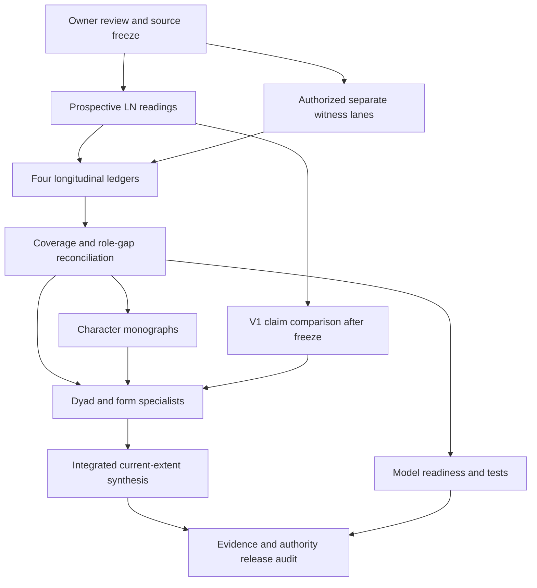

# Synthesis and corpus architecture

## Identity and governing scope

Generation SHUUKURA_V2 is a material analytical restart at `series/shuukura/`, continuing on `series/shuukura`. The current entrypoint, [method](SHUUKURA_ANALYTICAL_METHOD.md), [source inventory](SHUUKURA_SOURCE_INVENTORY.md) and [reconstruction contract](SHUUKURA_CHARACTER_RECONSTRUCTION_CONTRACT.md) are distinct governing responsibilities. The INITIAL architecture was owner-review-pending at bootstrap; the later continuous-execution instruction adopts it for this run. Its operational rules are not literary authority about unread sources. V1 remains HISTORICAL/LEGACY without byte changes or a fabricated reciprocal supersession relation. V2 replaces the current retrieval route, not the historical evidence of what V1 said.

The applicable initiation, continuation, reasoning, topology, long-series, handoff, archive, integration, housekeeping and character-curation policies under `governance/` remain governing. In particular, initiation Sections 5.1–5.16 and its responsibility matrix are implemented below. The [entrypoint](../CURRENT_STATE_AND_CORPUS_MAP.md) is the one current first-read surface. Mutable source state lives only in the inventory; literary state lives only in the four named ledgers. No V2 narrative evidence is admitted at bootstrap.

## Source lanes and conflict responsibility

The preferred primary lane is published Japanese LN V01 onward in volume/spine order. The nine acquired EPUBs were byte-identified candidates at bootstrap. The later frozen execution inventory records their ordered admission and the exact additional lanes. V10 is scheduled, unacquired and excluded. Internal fiction is mandatory within each admitted volume; afterwords and illustrations are separately classified. Separately delivered author-written stories have their own source IDs and are required for the eventual **declared supplemental corpus**, subject to provenance/access and separately authorized reading.

Kakuyomu and Narō retain independent textual witness and revision identities. The proposed web responsibility combines an LN-to-web crosswalk with a separately frozen Kakuyomu reading lane; no web material may be skipped merely because titles match. Pending a textual equivalence assessment, plan a complete Kakuyomu lane through its explicitly frozen endpoint. After the independent LN prospective freeze, the owner may approve replacing demonstrably redundant web coverage with a traceable crosswalk plus selective rereading and a continuation lane. The skipped scope must be justified passage by passage, not presumed identical. Narō initially receives a completeness/revision crosswalk responsibility, with full separate reading required where differences, omissions or independent evidence cannot be covered by bounded comparison. These decisions are in the inventory, not retrospective claims of coverage.

For every discrepancy classify the live alternatives: edition revision, omission/addition, reordering, narrator access, character misunderstanding, changed intention, temporal difference, translation/extraction defect, adaptation staging or genuine unresolved inconsistency. Store witness alignment in the source inventory and interpretive alternatives in the claims ledger. No automatic harmonization or premature continuity split. A continuity label requires source-grounded justification and owner-visible scope amendment; until then record `CONTINUITY_RELATION_UNRESOLVED`.

## Responsibility matrix and output contracts

`active_provisional` is the bootstrap state for governing files and empty instruments. Future authored analyses begin provisional within an admitted boundary; canonical promotion requires the corresponding acceptance gate. Reserved paths below are naming contracts, not links to nonexistent artifacts or instructions to create placeholders.

| Output identity and home | Scope and inputs | Dependencies and acceptance | Authority / initialization |
| --- | --- | --- | --- |
| [SHUUKURA_ANALYTICAL_METHOD](SHUUKURA_ANALYTICAL_METHOD.md) | Evidence, Japanese, focalization and reading rules; governance and reconnaissance | Owner review; operational locator and prospective contract | Provisional; exists |
| [SHUUKURA_SOURCE_INVENTORY](SHUUKURA_SOURCE_INVENTORY.md) | All witness identities, components, alignment, admission/coverage, supplement routing and gaps | Metadata/bytes distinguished; later per-unit verification and frozen run manifest | Provisional; exists, zero narrative coverage |
| `02 Sequential Readings/SHUUKURA_V2_LN_V##_DEEP_READING.md` | One entire admitted LN, exact observations, language/form notes and freezes | OPEN authorized run; source check; all cumulative updates; endpoint/commit | Deferred; frozen prospective artifact after acceptance |
| `03 Web and Supplemental Readings/SHUUKURA_V2_<UNIT>_DEEP_READING.md` | One admitted web episode/group or named supplement, witness-specific | Independent lane order and cutoff; no imported LN/V1 conclusions as web facts | Deferred; same freeze contract |
| [Character state/readiness ledger](../04%20Longitudinal%20Ledgers/SHUUKURA_CHARACTER_STATE_AND_READINESS_LEDGER.md) | State transitions, motivation hypotheses, stable/temporary distinctions, knowledge references, domain readiness | Observation and claim references; no duplicate proposition truth store | Provisional schema; exists, zero evidence rows |
| [Directional relationship/rules ledger](../04%20Longitudinal%20Ledgers/SHUUKURA_RELATIONSHIP_RULE_AND_BOUNDARY_LEDGER.md) | Actor→other expectations, initiative/refusal/repair, negotiated rules, boundaries and commitments | Two directions distinct; events linked; each party's understanding explicit | Provisional schema; exists, zero evidence rows |
| [Disclosure/narration ledger](../04%20Longitudinal%20Ledgers/SHUUKURA_DISCLOSURE_AND_NARRATION_LEDGER.md) | Propositions, subject knowledge, narrator access, disclosure times and paired-account tensions | Separates presented fact, belief and inference; links claims rather than adjudicating them twice | Provisional schema; exists, zero evidence rows |
| [Claims/predictions/revisions ledger](../04%20Longitudinal%20Ledgers/SHUUKURA_CLAIMS_PREDICTIONS_AND_REVISIONS_LEDGER.md) | Material arguments, alternatives, forecasts, counterevidence, revisions and eventual V1 crosswalk | Versioned claims; frozen tests; V1 comparison only after independent boundary freeze | Provisional schema; exists, zero evidence rows |
| `05 Character Studies/SHUUKURA_<SUBJECT>_MONOGRAPH.md` | Evidence-rich person's development, psychology, language, relationships and narrative role | Longitudinal reconciliation; explicit state range; counterargument and semantic review | Deferred; individual treatment earned by evidence |
| [SHUUKURA_CHARACTER_RECONSTRUCTION_CONTRACT](SHUUKURA_CHARACTER_RECONSTRUCTION_CONTRACT.md) | Model state/input/output, evidence, time and knowledge limits, readiness and test protocol | Source-grounded domain coverage, independent exposure audit and owner review; no completed model | Provisional specification; exists |
| `05 Character Studies/SHUUKURA_<SUBJECT>_RECONSTRUCTION.md` | Operational model plus tests | Separate reconstruction contract; domain readiness and exposure-valid tests | Deferred; no model now |
| `06 Specialist Synthesis/SHUUKURA_DYAD_AND_SOCIAL_CONTEXT_SYNTHESIS.md` | Miyagi/Sendai in both directions and supporting relationships; rules, negotiation, agency, power, care and autonomy | Reconciled relationship/character/epistemic evidence and relevant monographs; no single-label verdict substituted for argument | Planned mandatory responsibility at scoped synthesis |
| `06 Specialist Synthesis/SHUUKURA_NARRATION_LANGUAGE_AND_FORM_SYNTHESIS.md` | Alternating focalization, reliability, information asymmetry, Japanese voice, motifs and thematic/narrative form | Reconciled claims and observations; distinguish narrator language from dialogue and performance | Planned mandatory responsibility at scoped synthesis |
| V1 comparison section in claims ledger | Historical claim, location, independent V2 evidence, disposition, alternatives and current home | Relevant V2 prospective freeze sealed first; no rewritten V1 bytes | Deferred comparison, initialized schema |
| `07 Integrated Synthesis/SHUUKURA_CURRENT_EXTENT_SYNTHESIS.md` | Integrated literary account through named witness boundary; cross-edition limits | Coverage and role-gap audit, specialists, monographs as justified, claim convergence, V1 comparison | Deferred; current extent, not series completion |
| `08 Audits and Handoffs/SHUUKURA_BOOTSTRAP_RECEIPT.md`, later scoped audit/transfer records | Bootstrap provenance; later source, semantic, model and release acceptance | Exact identities/files/hashes, checks and limitations; owner hold respected | Bootstrap exists; later records only for actual operations |

Character development and reconstruction readiness share one ledger because they use the same time-indexed evidence, but readiness never substitutes for development. The epistemic ledger owns proposition states; the character ledger holds links to that state at the selected time. The relationship ledger owns agreements and directional interactions; the claims ledger owns their interpretive adjudication. Motif, chronology and linguistic observations remain in sequential readings with claim tags/index references. A new dedicated ledger needs demonstrated recurring independent responsibility and an amendment, not symmetry.

## Dependency graph and assembly order

The branches are responsibilities, not permission to run concurrently. One active owner maintains shared ledgers and the entrypoint. Literary integration may finish while a model remains unready, but the release must truthfully separate these results. A failed behavioral test revises affected interpretations only where the failure bears on their evidence; it does not automatically erase a valid monograph. Material specialist disagreements return to source/claim adjudication and then only affected dependencies are revised.

## Atomic transaction and durable checkpoints

For each later authorized source unit:

1. Recover current main and stable-branch state, scope, governing revisions, previous durable endpoint and source inventory. Reconcile concurrent changes without rewriting history.
2. Verify the next unit's witness/hash, completeness, exact component order, locator derivative and capability. Check OPEN lock **and** explicit owner authorization, active run, matching next fields, start and terminal boundary.
3. Freeze entering knowledge, exclusions, live claims and predictions before inspection. A new context inherits verified prior state, not future conclusions.
4. Read every authorized component in source order; retain observation IDs, narrator/actor distinctions, consequential Japanese, local alternatives and source locators. Preserve first-encounter notes as the volume progresses.
5. Update each of the four cumulative homes with substantive deltas or an explicit reviewed no-change outcome. Store full observations only in the reading; ledger rows reference them.
6. Adjudicate due predictions and revise claims with counterevidence; record unfinished mandatory work rather than declaring it closed. Advance inventory component coverage only for inspected content.
7. Freeze the endpoint and transaction checklist, then update current state and next permitted operation consistently. Validate source locators, schemas, links, names, authority and exact staged paths.
8. Commit the complete unit and synchronized state durably. A drafted reading alone never advances the verified high-water mark. After an ambiguous commit inspect actual Git state before retrying; retain the source receipt and endpoint hashes.
9. Publish coherent tranches through author preflight, source audit, housekeeping and the final integration audit. Do not push the next tranche before the prior publication sequence closes except the policy's diagnosed-repair case. A local durable commit and a publicly audited head are distinct checkpoints.

At run completion both recognized next fields become `NONE`, run state becomes `completed`, and no new source is implied. The architecture lock may remain OPEN between authorized runs under live policy, but that is not permission for another run. If a run seal is chosen, add the project-local closure only after its completion commit is on main and preserve every previous seal; terminal closure requires the separately governed control route. Do not create a fake completed run or closure record for this zero-reading bootstrap.

## Continuous routing, publication milestones and recovery

At bootstrap no sequential execution block was active. The current entrypoint now owns the authorized active run. After owner acceptance and source admission, declare the exact `single_operation` or `continuous_sequential` mode, unit type, `authorized_start`, `terminal_boundary`, `committed_high_water_mark`, `next_candidate_operation`, confirmation rule and `run_state: active`. Keep `project_initialization.next_permitted_operation` equal to the next candidate. Continuous authority comes only from the later owner instruction; this architecture does not supply it.

Freeze the run's source set before the first reading. Re-enumerate Drive; identify revisions and bytes; admit exact units; record unavailable mandatory components and explicitly excluded sources; store full deterministic locator/evidence manifests in Drive and a public-safe analytical routing record in Git. Record date/time/timezone, edition policy, stop boundary and a digest of the ordered IDs/hashes. Do not silently add V10 or later web episodes when they appear. A later acquisition is another scope decision.

For N frozen atomic units, plan progress reviews after `ceil(N/4)`, `ceil(N/2)`, `ceil(3N/4)` and N, deduplicating coincident small-N boundaries. For a nine-volume LN-only run these are V03, V05, V07 and V09. Publish complete audited units/tranches earlier when coherent; the quarter points are architecture, source-gap and readiness reviews, not a reason to withhold all work. Count supplement and web lanes separately so a volume percentage does not imply franchise coverage.

After interruption, inspect the live entrypoint, target and immediately following artifacts, endpoint hashes, ledger revisions, inventory and actual Git commits. Classify any partially written transaction before proceeding. Never redo an already verified unit or roll back a newer ledger on the basis of remembered progress. Recover from canonical state after compaction. A new session may continue the same explicitly bounded authorization; it cannot expand it.

## Synthesis dispatch and reasoning/capability ownership

| Operation | Preferred owner and reasoning class | Required evidence/capability |
| --- | --- | --- |
| Architecture and source topology | Fresh adequately grounded cloud or Work session; DEEP_SYNTHESIS, escalate propagation-sensitive design to PREMIUM_QUALITY_FIRST | Live governance, metadata, exact source access; no narrative conclusions required |
| Source identity and deterministic checks | Authorized Git/evidence operator; BOUNDED_STANDARD, deterministic checks ROUTINE_FAST | Intact bytes, decoding, hash/locator tooling |
| Sequential reading and cumulative updates | Work/Codex with verified Japanese text/image access; SUBSTANTIVE_ANALYSIS | Full admitted unit, prospective freezes, stable cumulative state |
| Checkpoints and claim reconciliation | DEEP_SYNTHESIS | Frozen evidence boundary, counterevidence and revision chain |
| Monographs and specialists | Fresh cloud synthesis session preferred; DEEP_SYNTHESIS | Full relevant readings/ledgers, recoverable primary witnesses, unresolved questions |
| Integrated synthesis and adversarial model audit | PREMIUM_QUALITY_FIRST when cross-source propagation warrants it | Stabilized specialists, contradiction/coverage audit and explicit test scope |
| Required audio/AV completion | Capability-verified assigned observer plus integrator | Actual relevant modality exposure; decoding/transcripts alone do not qualify |
| Git integration | Authorized repository operator, specialized housekeeping/curation owners retained | Exact-tree validation, identities, live provider checks and owner-controlled merge |

Stable classes are design responsibilities, not claims about a particular model having run. Resolve current provider/model/effort at the next actual phase using live policy and available capabilities. This bootstrap uses hosted Work tools and deterministic structural inspection; no audio/continuous AV capability is certified and no such claim is needed for its scope.

A substantive handoff follows the existing governance template and includes exact base/branch, artifact IDs/paths, source and knowledge boundary, full outputs with hashes, input retrieval routes, inspection coverage, unresolved required/optional debts, producer/receiver roles, authorization and acceptance criteria. A fresh synthesis session gets a frozen snapshot, not just a short summary or accumulated conversation. The integrator compares base/candidate/current, preserves supported reasoning and counterarguments, verifies source claims and named references, and returns material premise changes to the affected authoring responsibility before promotion. No automatic main merge or character curation follows handoff acceptance.

## Completion gates

| Gate | Recoverable acceptance condition | Does not imply |
| --- | --- | --- |
| G0 Bootstrap | Method, architecture, source inventory, reconstruction contract, four initialized instruments and current route reviewed; global routing conflict resolved through authorized workflow | Owner approval, reading authorization or OPEN lock |
| G1 Admission | Exact authorized run freeze, acquired/verified witnesses, language/edition/component checks, persistent locator routes, OPEN and consistent active run state | Narrative inspection |
| G2 Sequential coverage | Every frozen unit has complete admitted-component reading, entering/endpoint freeze, ledger updates and durable verified commit; unresolved skips explicit | Longitudinal reconciliation or full-series completion |
| G3 Longitudinal reconciliation | Character/directional/epistemic states agree by time; claims/predictions adjudicated; contradictions and backfill bounded; source coverage reconciled | Specialist readiness for an unsupported domain |
| G4 Specialists | Role-gap audit; justified monographs; dyadic/social and narration/form arguments; V1 dispositions after independent freeze; required cross-witness work scoped and supported | Integrated argument or behavioral validity |
| G5 Models | Domain readiness, explicit knowledge/state contract, preserved fit/test distinction, countercases and failures reviewed under reconstruction contract | Literary completion, general simulation ability or all domains ready |
| G6 Integrated synthesis | Specialists converge into a source-bounded argument; current extent, exclusions and continuing-series status explicit | Actual end of the narrative series |
| G7 Release | Evidence/authority/names/locators, source gaps and V1 preservation audited; exact-head repository checks, permitted integration and post-merge audit pass | Permission to read new releases |

LN-only current-extent synthesis can be valid if its exclusions are explicit; a comprehensive multi-witness release requires the separately defined web/supplement responsibilities or a reviewed bounded deferral. A missing mandatory source blocks only the completion claim depending on it, not useful completed independent work. Full-series wording is reserved for an actually verified terminal narrative boundary; an ongoing web work or a scheduled LN cannot be declared finished because the current inventory ends.

## V1 comparison and archive behavior

Substantive V1 comparison normally begins only after the independent V2 prospective freeze for the same relevant boundary. Freeze the independent claims before opening the historical interpretation. The claims ledger's V1 crosswalk records exact historical path/section/claim, V2 evidence, current argument, strongest counterevidence, transition and rationale, authoritative current home and unresolved disagreements. Use all six standard dispositions; surviving V1 claims are preserved, strengthened only with evidence, and never rejected merely for being old.

An archive title or manifest entry is only a provenance lead. It does not admit its alleged source or demonstrate fresh inspection. The transcript's uncertainty about whether turn 0 was captured remains explicit. Preserve the V1 original-source hashes and Git-normalization hashes as different objects. Do not cosmetically fix historical internal path spellings or metadata inside the preserved archive.

Current entrypoint, inventory and cumulative ledgers remain mutable through targeted edits with versioned history. Accepted unit readings and prospective predictions remain frozen; revisions live in claim/erratum homes. New specialist or ledger responsibility requires recurrence, independent retrieval value or a material evidence gap not served by existing homes. Record the rationale, dependencies, new version and targeted backfill in architecture/current state; do not recreate earlier readings wholesale. Initial revision: bootstrap only, zero literary findings.

Revision 0.2: record owner adoption and route the active run to the current entrypoint and inventory. The frozen available set contains 458 units; named unavailable sources and 27 bounded discovery records remain mandatory completion debts. A missing supplement does not block the independent LN lane. Added publisher stories use the existing supplemental-reading responsibility, with direct image reading after LN09; no duplicate canonical synthesis or ledger is introduced.
